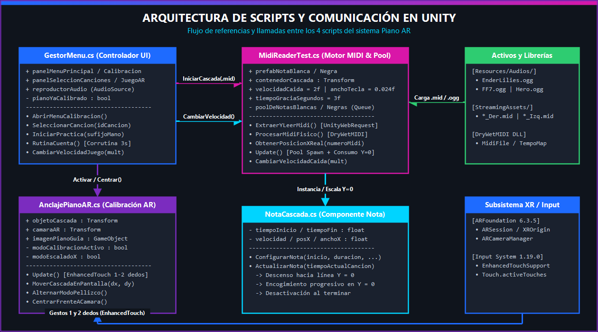
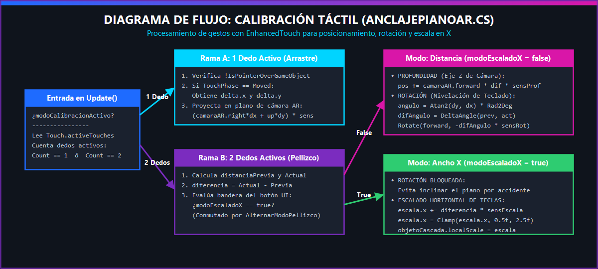
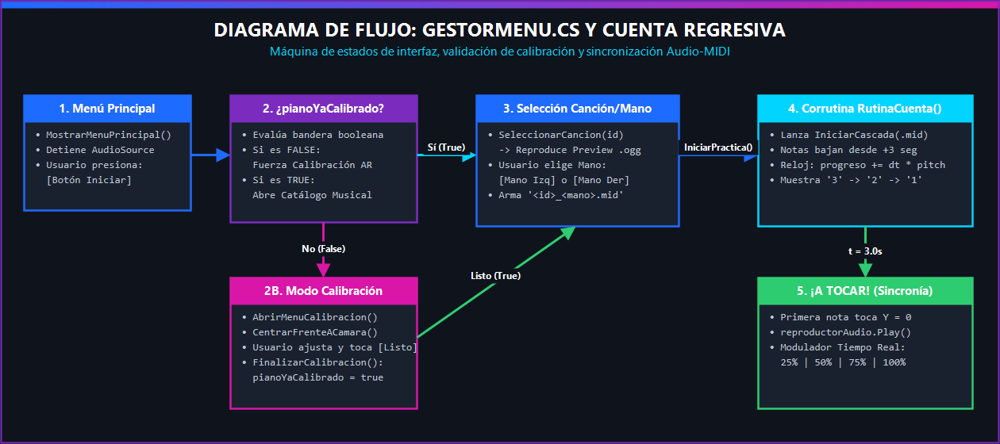
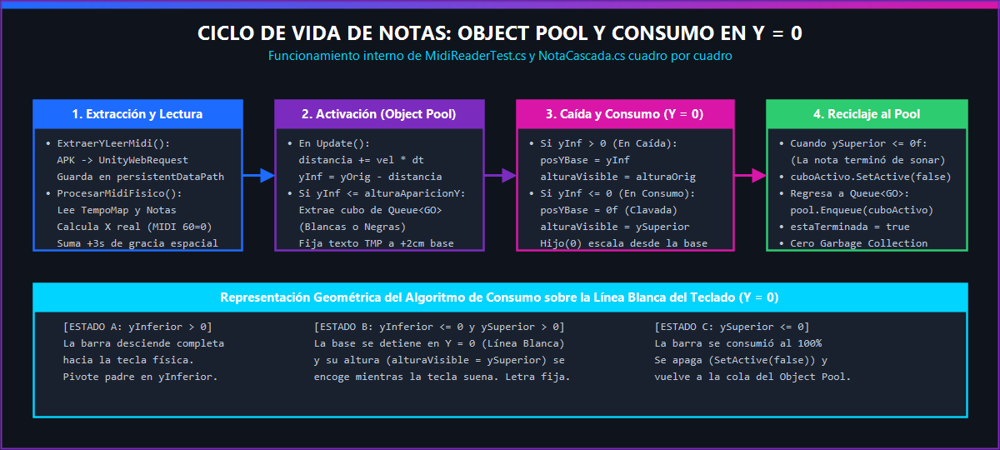

# UNIVERSIDAD NACIONAL AUTÓNOMA DE MÉXICO
## FACULTAD DE INGENIERÍA
### DIVISIÓN DE INGENIERÍA ELÉCTRICA
### INGENIERÍA EN COMPUTACIÓN
### TEMAS SELECTOS 3: DE REALIDAD VIRTUAL Y REALIDAD AUMENTADA

---

# MANUAL TÉCNICO DEL PROYECTO FINAL: PIANO AR
**NOMBRE:** Fernando David Martínez Navarro  
**N° DE CUENTA:** 421053610  
**TEMÁTICA:** Educación e Innovación Tecnológica  
**MOTOR DE DESARROLLO:** Unity 6 (6000.3.11f1) / ARFoundation 6.3.5  
**FECHA DE ENTREGA:** 18 de noviembre de 2026  

---

## Introducción y Contexto del Proyecto

### Temática y Objetivo
El proyecto **Piano AR** se desarrolla dentro de la temática de **Educación e Innovación Tecnológica**. Su objetivo principal es ofrecer una aplicación móvil de Realidad Aumentada (AR) para dispositivos Android que facilite el aprendizaje musical interactivo en teclados y pianos físicos reales.

A diferencia del aprendizaje tradicional basado exclusivamente en la lectura de partituras (solfeo), el cual suele generar una curva de aprendizaje pronunciada y frustración temprana en estudiantes principiantes, **Piano AR** proyecta una interfaz tridimensional en cascada (inspirada en herramientas visuales como *Synthesia* y *PianoVision*) directamente sobre las teclas físicas del instrumento del usuario. De esta forma, el estudiante visualiza los bloques de notas acercándose a las teclas en el tempo exacto de la pista musical, fomentando la repetición guiada, la coordinación motora (mano izquierda y mano derecha por separado) y la memorización progresiva de patrones musicales.

### Alcance Técnico Implementado en el Prototipo
De acuerdo con la planeación del proyecto, el prototipo funcional cumple con los siguientes sistemas técnicos:
* **Interpretación y decodificación de archivos MIDI:** Extracción automática de eventos de nota (tono MIDI de 0 a 127, instante de inicio en microsegundos, duración y mapa de tempo) para instanciar y dimensionar en tiempo real los bloques visuales 3D sobre las coordenadas físicas reales de un teclado estándar (con ancho de tecla blanca de 2.4 cm).
* **Catálogo precargado con separación por manos:** Biblioteca integrada por 3 piezas musicales (*Ender Lilies*, *Final Fantasy VII* y *Hero*), cada una con su pista de audio en formato `.ogg` y sus respectivos archivos `.mid` separados para práctica de mano derecha (`_Der.mid`) y mano izquierda (`_Izq.mid`).
* **Modulador de Tempo en Tiempo Real:** Sistema capaz de ralentizar o restaurar simultáneamente tanto la velocidad de caída geométrica de las notas como el *pitch* (velocidad de reproducción) de la pista de audio en cuatro niveles: **25%, 50%, 75% y 100%**.
* **Sistema de Calibración Espacial Táctil con Guía Visual:** Permite alinear, trasladar, acercar/alejar, rotar y escalar horizontalmente la cascada 3D utilizando gestos multitáctiles (`EnhancedTouch`) sobre una plantilla guía superpuesta al teclado físico a través de la cámara AR.
* **Efecto Visual de Consumo de Notas en Línea de Golpe (Y = 0) y Object Pooling:** Al tocar el borde de las teclas físicas (`Y = 0`), las notas detienen su base y reducen dinámicamente su escala vertical a medida que se "consumen", reciclando las instancias 3D mediante colas (`Queue<GameObject>`) para mantener una tasa estable de cuadros por segundo (FPS) sin generar basura en memoria (*Garbage Collection*).

---

## Cronograma de Actividades: Comparativa Propuesto vs. Real

A continuación, se presenta la tabla comparativa entre el cronograma estimado originalmente en la propuesta del proyecto y los periodos reales que tomó la implementación técnica de cada actividad:

| Actividad / Tarea | Cronograma Propuesto | Cronograma Real | Comparativa y Observaciones del Desarrollo Real |
| :--- | :--- | :--- | :--- |
| **1. Investigación de herramientas y librerías** | 21 sep – 11 oct | **21 sep – 2 oct** | Se concluyó 9 días antes de lo previsto al encontrar e integrar rápidamente la librería **Melanchall DryWetMIDI** y definir el uso de **ARFoundation / ARCore**. |
| **2. Creación de proyecto base** | 23 sep – 25 sep | **23 sep – 25 sep** | Cumplido en tiempo exacto. Creación del proyecto en **Unity 6 (6000.3.11f1)**, control de versiones en Git y estructura de carpetas. |
| **3. Instalación de librerías y herramientas** | 11 oct – 15 oct | **2 oct – 3 oct** | Se adelantó inmediatamente después de terminar la fase de investigación para comenzar las pruebas de lectura MIDI y AR cuanto antes. |
| **4. Diseño borrador del menú principal** | 7 oct – 11 oct | **7 oct – 11 oct** | Cumplido en tiempo exacto. Estructuración de paneles en Canvas 2D. |
| **5. Sistema de detección de sonido** | 8 oct – 12 oct | **Descartado por alcance** | Se descartó tal como se delimitó en el apartado *"Fuera del alcance en el prototipo"* de la propuesta (sin evaluación por micrófono), priorizando la guía visual en tiempo real. |
| **6. Creación de modelos 3D de las teclas / notas** | 11 oct – 12 oct | **11 oct – 12 oct** | Cumplido en tiempo exacto. Creación de los Prefabs `NotaBlancaBase 1` y `NotaNegraBase 1` con jerarquía independiente para la malla y el texto `TextMeshPro`. |
| **7. Creación de archivos MIDI y pistas de audio** | 15 oct – 20 oct | **15 oct – 25 oct** | Se extendió 5 días adicionales en **FL Studio** para limpiar y separar cuidadosamente las pistas de mano izquierda (`_Izq.mid`) y mano derecha (`_Der.mid`) de las 3 canciones. |
| **8. Detección de piano / Calibración espacial** | 15 oct – 26 oct | **15 oct – 13 nov** | Fue la actividad que requirió mayor tiempo de ingeniería (extendiéndose hasta el 13 de noviembre), ya que tras probar el seguimiento por marcador impreso (*Image Target*) y detectar temblores por iluminación, se rediseñó por completo hacia el sistema de **Calibración Táctil Multigestos (`EnhancedTouch`)** con guía visual. |
| **9. Lógica de generación de cascada** | 20 oct – 23 oct | **20 oct – 23 oct** | Cumplido en las fechas planeadas; posteriormente se refinó con el algoritmo de consumo de notas en la línea de golpe (`Y = 0`). |
| **10. Programación de modulador de tempo** | 23 oct – 26 oct | **23 oct – 30 oct** | Se extendió 4 días para sincronizar la velocidad de caída geométrica con el `pitch` del `AudioSource` y con la cuenta regresiva inicial. |
| **11. Programación de UI (`GestorMenu.cs`)** | 26 oct – 31 oct | **26 oct – 13 nov** | Se extendió a la par del sistema de calibración para integrar el panel de calibración obligatorio (`pianoYaCalibrado`) y el botón selector de modo (`Modo: Distancia` / `Modo: Ancho X`). |
| **12. Sincronización de audio** | 1 nov – 4 nov | **1 nov – 4 nov** | Cumplido en tiempo exacto implementando el colchón espacial de anticipación de 3 segundos (`tiempoGraciaSegundos = 3f`). |
| **13. Creación de imágenes para botones de interfaz** | 12 oct – 15 oct | **11 nov – 14 nov** | Se reprogramó para la etapa final una vez que todos los botones definitivos de la interfaz quedaron definidos, aplicando la identidad visual final y la guía del teclado. |
| **14. Pruebas de funcionamiento** | 5 nov – 12 nov | **5 nov – 20 nov** | Se extendió hasta el 20 de noviembre para validar en el dispositivo **Infinix GT30 Pro** y el piano **Alesis Recital** la extracción de `StreamingAssets` en Android y la precisión del nuevo ajuste táctil. |
| **15. Preparación de exposición y documentación** | 13 nov – 17 nov | **13 nov – 20 nov** | Elaboración del Manual Técnico, Manual de Usuario y material de demostración final del proyecto. |

---

## Tecnologías, Herramientas y Requerimientos de Hardware/Software

### Software y Librerías empleadas en el Desarrollo
1. **Motor Gráfico:** **Unity 6 (Versión `6000.3.11f1`)** bajo licencia personal gratuita.
2. **Framework de Realidad Aumentada:**
   * **Unity AR Foundation (`com.unity.xr.arfoundation` v6.3.5):** API multiplataforma para la gestión de la sesión AR (`ARSession`), cámara AR (`XROrigin` / `ARCameraManager`) y renderizado del fondo de cámara en tiempo real.
   * **Google ARCore XR Plugin (`com.unity.xr.arcore` v6.3.5):** Backend nativo de seguimiento espacial para dispositivos Android compatibles con ARCore.
3. **Sistema de Entrada Táctil:** **Unity Input System (`com.unity.inputsystem` v1.19.0)** utilizando específicamente la API `UnityEngine.InputSystem.EnhancedTouch` para lectura de alta precisión de deltas de movimiento con 1 dedo y gestos compuestos de 2 dedos (pellizco de escala/profundidad y ángulo de rotación).
4. **Procesamiento Musical MIDI:** **Melanchall DryWetMIDI (`Melanchall.DryWetMidi.dll`)**, librería de código abierto bajo licencia permisiva (MIT) utilizada para decodificar archivos `.mid` binarios, extraer el mapa de tempo (`TempoMap`) y convertir tiempos musicales a microsegundos métricos (`MetricTimeSpan`).
5. **Interfaz Gráfica y Texto 3D:** **Unity UI (`com.unity.ugui` v2.0.0)** y **TextMeshPro (`TMPro`)** para el renderizado nítido tanto de los menús 2D como de las etiquetas con el cifrado americano (`C`, `C#`, `D`, etc.) adheridas a la base de cada nota 3D.
6. **Herramientas Externas de Producción:**
   * **FL Studio (Producer Edition):** Edición, limpieza y separación de canales de mano izquierda/derecha en los archivos `.mid`, así como exportación de los archivos de audio `.ogg`.
   * **Canva Pro y GIMP:** Diseño de elementos de interfaz de usuario y máscara guía del teclado.
   * **Blender:** Referencia y modelado geométrico base.

### Hardware Utilizado en Desarrollo y Pruebas
* **Estación de trabajo:** Laptop **Asus TUF Gaming F15**.
* **Dispositivo móvil de pruebas AR:** Smartphone **Infinix GT30 Pro** con soporte para Google Play Services for AR (ARCore).
* **Instrumento musical de referencia:** Teclado digital **Alesis Recital** (teclas de tamaño estándar con ancho de tecla blanca de 2.4 cm), complementado con trípode para sujeción del dispositivo móvil y cableado USB/MIDI.

---

## Estructura Técnica del Proyecto en Unity

El proyecto sigue una organización modular dentro del directorio raíz `Assets/` para separar claramente el código fuente, los activos multimedia cargados dinámicamente y la configuración de Realidad Aumentada:

```
Assets/
├── InputSystem_Actions.inputactions   # Mapa de acciones del nuevo Input System de Unity
├── Marcadores/                        # Imágenes de referencia y XRReferenceImageLibrary (Marcador.asset)
│   ├── PianoAR61.jpg
│   └── PianoAR81.jpg
├── Materiales/                        # Materiales de renderizado para notas blancas, negras y paneles
│   ├── MaterialPanel.mat
│   ├── Piano.mat
│   ├── Rojo.mat / Rojo 1.mat          # Materiales distintivos para diferenciar teclas blancas y sostenidos
│   └── 1.png / 2.png
├── Melanchall/                        # Librería externa DryWetMIDI para lectura de archivos .mid
│   └── DryWetMIDI/
│       ├── Melanchall.DryWetMidi.dll
│       ├── Melanchall_DryWetMidi_Native32.dll
│       └── Melanchall_DryWetMidi_Native64.dll
├── Prefabs/                           # Objetos prefabricados reutilizables en el Object Pool
│   ├── NotaBlancaBase 1.prefab        # Prefab para notas naturales (C, D, E, F, G, A, B)
│   ├── NotaNegraBase 1.prefab         # Prefab para notas sostenidas/bemoles (C#, D#, F#, G#, A#)
│   └── Cube.prefab / Cube 1.prefab
├── Resources/                         # Activos cargados en tiempo de ejecución vía Resources.Load()
│   └── Audios/
│       ├── EnderLilies.ogg            # Pista de audio para la canción Ender Lilies
│       ├── FF7.ogg                    # Pista de audio para la canción Final Fantasy VII
│       └── Hero.ogg                   # Pista de audio para la canción Hero
├── Scenes/                            # Escenas del proyecto
│   ├── Piano.unity                    # Escena principal de producción (Menús + Sesión AR + Cascada)
│   └── SampleScene.unity              # Escena de pruebas iniciales
├── Scripts/                           # Lógica de programación en C#
│   ├── AnclajePianoAR.cs              # Controlador de calibración táctil 3D y alineación AR
│   ├── GestorMenu.cs                  # Controlador de flujo de pantallas UI, audio y cuenta regresiva
│   ├── MidiReaderTest.cs              # Motor lector de MIDI, cálculo métrico, Object Pool y cascada
│   ├── NotaCascada.cs                 # Componente modular de comportamiento individual de nota
│   └── LectorMIDI.cs                  # (Script obsoleto de primeras pruebas, fuera de uso)
├── StreamingAssets/                   # Archivos binarios .mid empaquetados sin compresión de Unity
│   ├── EnderLilies_Der.mid            # Notas de mano derecha - Ender Lilies
│   ├── EnderLilies_Izq.mid            # Notas de mano izquierda - Ender Lilies
│   ├── FF7_Der.mid                    # Notas de mano derecha - Final Fantasy VII
│   ├── FF7_Izq.mid                    # Notas de mano izquierda - Final Fantasy VII
│   ├── Hero_Der.mid                   # Notas de mano derecha - Hero
│   └── Hero_Izq.mid                   # Notas de mano izquierda - Hero
├── TextMesh Pro/                      # Shaders, fuentes y recursos tipográficos de TMP
├── UI/                                # Recursos visuales para la interfaz de usuario
│   └── Piano.png / Piano (1).png      # Imagen guía superpuesta durante el modo de calibración
└── XR/                                # Configuraciones de ARCore Loader y XR Simulation
```

---

## Procedimientos Técnicos de Implementación

Al igual que en las prácticas previas de computación gráfica, para lograr que los elementos tridimensionales interactúen de manera coherente con el usuario y con las dimensiones del mundo real, se diseñaron cuatro procedimientos matemáticos y algorítmicos fundamentales:



### Procedimiento de Conversión de Notas MIDI a Coordenadas Físicas Reales
En el protocolo MIDI estándar, cada nota musical se identifica mediante un número entero entre 0 y 127, donde el **Do Central (C4)** corresponde al número **MIDI 60**, y cada octava está compuesta por **12 semitonos** (7 teclas blancas y 5 teclas negras o sostenidos).

Para que las notas virtuales caigan exactamente encima de las teclas físicas de un piano real, no basta con colocar los cubos a una distancia uniforme por cada semitono, debido a que en un teclado real las teclas negras están intercaladas entre las blancas (excepto entre **Mi–Fa** y **Si–Do**, donde no hay tecla negra).

Por ello, en `MidiReaderTest.cs` se implementó la función `ObtenerPosicionXReal(int numeroMidi)`:
1. Primero se calcula la distancia en semitonos respecto al Do Central: `distanciaMidi = numeroMidi - 60`.
2. Se obtiene el desplazamiento en octavas completas usando la función piso: `octavas = Mathf.FloorToInt((float)distanciaMidi / 12f)`.
3. Se obtiene el índice de la nota dentro de su propia octava (0 a 11): `notaEnOctava = distanciaMidi - (octavas * 12)`.
4. Se creó un arreglo de factores de posición física para los 12 semitonos:
   `posiciones = { 0f, 0.5f, 1f, 1.5f, 2f, 3f, 3.5f, 4f, 4.5f, 5f, 5.5f, 6f }`.
   Como se observa, entre el índice 4 (**Mi**, factor `2.0f`) y el índice 5 (**Fa**, factor `3.0f`) existe un salto entero de `1.0f` (el ancho completo de una tecla blanca), mientras que en las demás notas con sostenido el avance es de `0.5f` (la mitad de una tecla blanca).
5. Finalmente, sabiendo que una octava física mide el ancho de 7 teclas blancas (`anchoOctavaFisica = 7f * anchoTecla`, donde `anchoTecla = 0.024f` metros), la coordenada horizontal X se obtiene mediante:
   $$X = (\text{octavas} \times 7 \times \text{anchoTecla}) + (\text{posiciones}[\text{notaEnOctava}] \times \text{anchoTecla})$$

### Procedimiento de Consumo Visual de Notas en la Línea de Golpe (Y = 0)
En la primera versión del prototipo, las notas simplemente atravesaban el plano del teclado hacia abajo hasta desaparecer en `Y = -2 m`. Sin embargo, esto dificultaba saber visualmente en qué momento exacto una nota larga debía soltarse y además invadía visualmente la zona de las manos del pianista.

Para resolverlo, se modificó la jerarquía de los Prefabs (`NotaBlancaBase 1` y `NotaNegraBase 1`) y el cálculo en `Update()` de `MidiReaderTest.cs`:
* El objeto raíz del Prefab (`nota.cuboActivo`) actúa como el **pivote en la base (borde inferior)** de la nota.
* Su primer hijo (`cuboVisual = nota.cuboActivo.transform.GetChild(0)`) contiene la malla del cubo 3D. Como el cubo nativo de Unity tiene su pivote en el centro geométrico, se desplaza localmente hacia arriba la mitad de su altura visible:
  `cuboVisual.localPosition = new Vector3(0f, alturaVisible / 2f, 0f)`.
* Mientras la nota va cayendo y aún no toca el teclado (`yInferiorActual > 0f`), su base baja libremente (`posYBase = yInferiorActual`) conservando su tamaño completo (`alturaVisible = nota.alturaOriginal`).
* En el instante en que la base de la nota toca el teclado (`yInferiorActual <= 0f`), **la base se clava en `posYBase = 0f`** y la altura del bloque se reduce en cada fotograma al valor de su punta superior (`alturaVisible = ySuperiorActual`). Esto genera la ilusión visual perfecta de que la tecla del piano "absorbe" o "consume" la barra de luz mientras suena, hasta que `ySuperiorActual <= 0f`, momento en que se apaga y regresa al *Object Pool*.

### Procedimiento de Sincronización con Colchón Espacial de Gracia (3 Segundos)
Para evitar que al iniciar una canción las primeras notas aparezcan de golpe encima de las teclas sin darle tiempo de reacción al usuario, se sincronizaron `GestorMenu.cs` y `MidiReaderTest.cs`:
1. Al procesar el archivo MIDI, a la posición inicial de todas las notas se les suma un desfase espacial de 3 segundos (`offsetGraciaEspacial = tiempoGraciaSegundos * velocidadOriginal`).
2. Cuando el usuario selecciona la mano a practicar, la corrutina `RutinaCuenta()` arranca **inmediatamente** el movimiento de la cascada (`lectorMidi.IniciarCascada`) al mismo tiempo que muestra en pantalla `"3"`, `"2"`, `"1"`.
3. Durante esos 3 segundos de cuenta regresiva, el usuario ya ve las primeras notas descendiendo suavemente hacia su piano. Justo cuando el contador llega a cero y muestra `"¡A TOCAR!"`, la primera nota de la canción alcanza exactamente la coordenada `Y = 0` y en ese mismo milisegundo se ejecuta `reproductorAudio.Play()`.

### Procedimiento de Calibración Táctil en Pantalla (`EnhancedTouch`)
Como se identificó en los factores operativos de la propuesta, depender exclusivamente de un marcador impreso (*Image Target*) durante toda la canción provoca que, ante cambios de luz, reflejos en las teclas blancas o sombras de las manos del usuario, la cámara pierda el rastreo o las notas tiemblen.

Para solucionar definitivamente este problema, se programó en `AnclajePianoAR.cs` un sistema de calibración manual asistido por una silueta guía (`imagenPianoGuia`):
* **Con 1 dedo en pantalla:** Se lee el vector `toque.delta` y se proyecta sobre los vectores `camaraAR.right` y `camaraAR.up`, permitiendo arrastrar la cascada en el plano paralelo a la pantalla del teléfono.
* **Con 2 dedos en pantalla:** Se calcula la distancia euclidiana actual y previa entre ambos dedos (`diferenciaDistancia`) y se divide en dos modos seleccionables mediante un botón en la UI (`AlternarModoPellizco()`):
  1. **Modo Distancia y Rotación (`modoEscaladoX = false`):** Al separar o juntar los dedos, la cascada se acerca o aleja sobre el eje `camaraAR.forward`. Al girar ambos dedos, se calcula el ángulo trigonométrico con `Mathf.Atan2` y `Mathf.DeltaAngle`, rotando el contenedor sobre su eje frontal (`objetoCascada.forward`) para nivelarlo con la inclinación real del teclado.
  2. **Modo Ancho X (`modoEscaladoX = true`):** Bloquea por completo la rotación (para evitar desnivelar el piano por accidente) y utiliza el gesto de pellizco únicamente para estirar o encoger `objetoCascada.localScale.x` dentro de límites seguros (`0.5f` a `2.5f`), adaptándose a cualquier distancia o tamaño de teclado.

---

## Documentación Exhaustiva de Scripts

A continuación, se documentan en detalle las **4 clases activas** del proyecto ubicadas en `Assets/Scripts/` (excluyendo `LectorMIDI.cs`, el cual corresponde a una prueba descartada).

---

### Script: `AnclajePianoAR.cs`
**Ruta:** `Assets/Scripts/AnclajePianoAR.cs`

#### Propósito de la Clase
Administra la colocación, alineación y calibración espacial del contenedor 3D de la cascada de notas (`objetoCascada`) respecto a la cámara de Realidad Aumentada (`camaraAR`). Habilita el soporte multitáctil avanzado (`EnhancedTouchSupport`) y traduce los gestos de 1 y 2 dedos del usuario en transformaciones de traslación, profundidad, rotación y escalado horizontal.



#### Librerías Utilizadas
```csharp
using UnityEngine;
using UnityEngine.EventSystems;
using UnityEngine.InputSystem.EnhancedTouch;
using TMPro;
using Touch = UnityEngine.InputSystem.EnhancedTouch.Touch;
using TouchPhase = UnityEngine.InputSystem.TouchPhase;
```
* **`UnityEngine.EventSystems`:** Permite verificar con `IsPointerOverGameObject` si el dedo del usuario está tocando un botón de la interfaz gráfica para no mover el piano por accidente al pulsar botones.
* **`UnityEngine.InputSystem.EnhancedTouch`:** Proporciona acceso a `Touch.activeTouches` para leer múltiples dedos simultáneamente con alta precisión.

#### Tabla de Variables de `AnclajePianoAR`
| Variable | Tipo | Visibilidad | Valor por defecto | Qué controla / A qué se refiere |
| :--- | :--- | :--- | :--- | :--- |
| `objetoCascada` | `Transform` | `public` | *Inspector* | Transform del objeto raíz 3D donde caen las notas y que se mueve, rota y escala durante la calibración. |
| `camaraAR` | `Transform` | `public` | *Inspector* | Transform de la cámara AR principal (`Main Camera` dentro del `XROrigin`). Sus ejes `right`, `up` y `forward` sirven de referencia para mover la cascada respecto al punto de vista del jugador. |
| `imagenPianoGuia` | `GameObject` | `public` | *Inspector* | Objeto visual de referencia (silueta de piano) que se enciende solo mientras `modoCalibracionActivo` es `true` para que el usuario encaje las teclas virtuales con las reales. |
| `textoBotonModo` | `TMP_Text` | `public` | *Inspector* | Texto del botón en el Canvas que informa al usuario qué hace actualmente el gesto de 2 dedos (`"Modo: Distancia"` o `"Modo: Ancho X"`). |
| `sensibilidadMovimiento` | `float` | `public` | `0.002f` | Multiplicador de velocidad al arrastrar la cascada con 1 dedo en los ejes X/Y de la pantalla. |
| `sensibilidadProfundidad` | `float` | `public` | `0.003f` | Multiplicador de velocidad al acercar o alejar la cascada en el eje Z (`camaraAR.forward`) con 2 dedos. |
| `sensibilidadEscala` | `float` | `public` | `0.001f` | Multiplicador de sensibilidad al estirar o encoger el ancho horizontal (`localScale.x`) con 2 dedos. |
| `sensibilidadRotacion` | `float` | `public` | `0.4f` | Multiplicador de velocidad angular al girar 2 dedos en pantalla para inclinar la cascada. |
| `escalaMinimaX` | `float` | `public` | `0.5f` | Límite mínimo permitido para la escala horizontal en X (evita que la cascada colapse a cero o se invierta en negativo). |
| `escalaMaximaX` | `float` | `public` | `2.5f` | Límite máximo permitido para la escala horizontal en X. |
| `modoCalibracionActivo` | `bool` | `private [SerializeField]` | `false` | Bandera que bloquea o permite que los toques en pantalla muevan el piano. Es `true` únicamente dentro del menú de calibración. |
| `modoEscaladoX` | `bool` | `private [SerializeField]` | `false` | Define el comportamiento del gesto de 2 dedos: `false` = Profundidad + Rotación; `true` = Solo Escala en X (con rotación bloqueada). |

* **¿Qué se puede modificar de forma segura?:** Todas las variables bajo `[Header("Sensibilidad Táctil")]` y `[Header("Límites de Escala Horizontal")]` pueden ajustarse libremente en el Inspector si se desea un movimiento más rápido o más fino.
* **¿Qué NO se debe modificar?:** No dejar sin asignar `objetoCascada` ni `camaraAR`, ya que la función `Update()` abortará cualquier calibración si alguno de los dos es `null`.

#### Desglose de Funciones de `AnclajePianoAR`

**1. Activación de `EnhancedTouch` y Ciclo Inicial (`OnEnable`, `OnDisable`, `Start`)**
```csharp
void OnEnable()
{
    EnhancedTouchSupport.Enable();
}

void OnDisable()
{
    EnhancedTouchSupport.Disable();
}

void Start()
{
    ActualizarTextoBoton();
}
```
Se activa el subsistema `EnhancedTouchSupport` cuando el componente se habilita y se apaga al deshabilitarse para liberar recursos del sistema de entrada. En `Start()` se sincroniza la etiqueta del botón de modo.

**2. Procesamiento Multitáctil en `Update()`**
```csharp
void Update()
{
    if (!modoCalibracionActivo || objetoCascada == null || camaraAR == null) return;

    var toquesActivos = Touch.activeTouches;

    // 1 DEDO: MOVER EN EL PLANO DE LA CÁMARA
    if (toquesActivos.Count == 1)
    {
        Touch toque = toquesActivos[0];

        if (EventSystem.current != null && EventSystem.current.IsPointerOverGameObject(toque.touchId))
            return;

        if (toque.phase == TouchPhase.Moved)
        {
            MoverCascadaEnPantalla(toque.delta.x, toque.delta.y);
        }
    }
    // 2 DEDOS: DEPENDE DEL MODO SELECCIONADO CON EL BOTÓN
    else if (toquesActivos.Count == 2)
    {
        Touch toque1 = toquesActivos[0];
        Touch toque2 = toquesActivos[1];

        if (toque1.phase == TouchPhase.Moved || toque2.phase == TouchPhase.Moved)
        {
            Vector2 posActual1 = toque1.screenPosition;
            Vector2 posActual2 = toque2.screenPosition;
            Vector2 posPrevia1 = posActual1 - toque1.delta;
            Vector2 posPrevia2 = posActual2 - toque2.delta;

            float distanciaPrevia = (posPrevia1 - posPrevia2).magnitude;
            float distanciaActual = (posActual1 - posActual2).magnitude;
            float diferenciaDistancia = distanciaActual - distanciaPrevia;

            if (modoEscaladoX)
            {
                // --- MODO ESCALA X (Rotación bloqueada para evitar accidentes) ---
                Vector3 escalaActual = objetoCascada.localScale;
                escalaActual.x = Mathf.Clamp(escalaActual.x + (diferenciaDistancia * sensibilidadEscala), escalaMinimaX, escalaMaximaX);
                objetoCascada.localScale = escalaActual;
            }
            else
            {
                // --- MODO PROFUNDIDAD (Acerca/Aleja + Rotación habilitada) ---
                objetoCascada.position += camaraAR.forward * (diferenciaDistancia * sensibilidadProfundidad);

                float anguloPrevio = Mathf.Atan2(posPrevia2.y - posPrevia1.y, posPrevia2.x - posPrevia1.x) * Mathf.Rad2Deg;
                float anguloActual = Mathf.Atan2(posActual2.y - posActual1.y, posActual2.x - posActual1.x) * Mathf.Rad2Deg;
                float diferenciaAngulo = Mathf.DeltaAngle(anguloPrevio, anguloActual);

                objetoCascada.Rotate(objetoCascada.forward, -diferenciaAngulo * sensibilidadRotacion, Space.World);
            }
        }
    }
}
```
* Si `modoCalibracionActivo` es `false` (por ejemplo, cuando el usuario ya está tocando una canción), `Update()` termina de inmediato y el piano queda completamente fijo en el espacio.
* Cuando detecta **1 dedo** en fase `TouchPhase.Moved` que no esté sobre un botón de UI, traslada el objeto usando `MoverCascadaEnPantalla()`.
* Cuando detecta **2 dedos**, reconstruye la posición del frame anterior restando `toque.delta` a `screenPosition`, compara las magnitudes de distancia entre ambos dedos y aplica ya sea el escalado restringido con `Mathf.Clamp` (si `modoEscaladoX` es `true`) o el avance en profundidad junto con la rotación trigonométrica `Mathf.Atan2` (si `modoEscaladoX` es `false`).

**3. Funciones Auxiliares y de Control de Modo**
```csharp
public void AlternarModoPellizco()
{
    modoEscaladoX = !modoEscaladoX;
    ActualizarTextoBoton();
}

private void ActualizarTextoBoton()
{
    if (textoBotonModo != null)
    {
        textoBotonModo.text = modoEscaladoX ? "Modo: Ancho X" : "Modo: Distancia";
    }
}

private void MoverCascadaEnPantalla(float deltaX, float deltaY)
{
    Vector3 direccion = (camaraAR.right * deltaX + camaraAR.up * deltaY) * sensibilidadMovimiento;
    objetoCascada.position += direccion;
}

public void CentrarFrenteACamara()
{
    if (objetoCascada != null && camaraAR != null)
    {
        objetoCascada.position = camaraAR.position + (camaraAR.forward * 0.4f);
        objetoCascada.rotation = camaraAR.rotation;
    }
}

public void ActivarModoCalibracion()
{
    modoCalibracionActivo = true;
    if (objetoCascada != null) objetoCascada.gameObject.SetActive(true);
    if (imagenPianoGuia != null) imagenPianoGuia.SetActive(true);
}

public void DesactivarModoCalibracion()
{
    modoCalibracionActivo = false;
    if (imagenPianoGuia != null) imagenPianoGuia.SetActive(false);
}
```
* **`AlternarModoPellizco()`:** Se conecta al botón de modo en el panel de calibración para conmutar entre ajustar la distancia/rotación y ajustar el ancho horizontal.
* **`CentrarFrenteACamara()`:** Coloca la cascada a 40 cm (`0.4f` metros) justo enfrente de donde esté mirando la cámara AR en ese instante y alinea su rotación con la cámara. Se invoca automáticamente la primera vez que el usuario entra a calibrar o mediante un botón de "Recalibrar / Centrar".
* **`ActivarModoCalibracion()` / `DesactivarModoCalibracion()`:** Habilitan o apagan la recepción de gestos táctiles y muestran u ocultan la guía visual (`imagenPianoGuia`).

---

### Script: `GestorMenu.cs`
**Ruta:** `Assets/Scripts/GestorMenu.cs`

#### Propósito de la Clase
Controla toda la máquina de estados de la interfaz de usuario (Menú Principal $\leftrightarrow$ Calibración $\leftrightarrow$ Selección de Canciones $\leftrightarrow$ Juego AR), obliga a que el usuario calibre el piano antes de su primera partida, administra la carga y previsualización de pistas de audio desde `Resources/Audios/` y coordina la cuenta regresiva sincronizada con el colchón espacial del lector MIDI.



#### Tabla de Variables de `GestorMenu`
| Variable | Tipo | Visibilidad | Valor por defecto | Qué controla / A qué se refiere |
| :--- | :--- | :--- | :--- | :--- |
| `panelMenuPrincipal` | `GameObject` | `public` | *Inspector* | Panel UI de portada con los botones de Iniciar, Calibrar y Salir. |
| `panelSeleccionCanciones` | `GameObject` | `public` | *Inspector* | Panel UI donde se eligen las canciones y la mano a practicar. |
| `panelJuegoAR` | `GameObject` | `public` | *Inspector* | Panel UI de práctica activa (contiene botones de velocidad 25%–100% y botón de regreso). |
| `panelDeCalibracion` | `GameObject` | `public` | *Inspector* | Panel UI que muestra las instrucciones y botones del modo de calibración táctil. |
| `contenedorOpcionesMano` | `GameObject` | `public` | *Inspector* | Sub-panel con los botones de Mano Izquierda (`Izq`) y Mano Derecha (`Der`). Se activa solo tras elegir una canción. |
| `textoTituloCancion` | `TextMeshProUGUI` | `public` | *Inspector* | Etiqueta que indica la pista seleccionada actualmente. |
| `lectorMidi` | `MidiReaderTest` | `public` | *Inspector* | Referencia al motor `MidiReaderTest` para iniciar/detener la cascada y ajustar velocidades. |
| `reproductorAudio` | `AudioSource` | `public` | *Inspector* | Componente encargado de reproducir los archivos `.ogg` de las canciones. |
| `scriptAnclaje` | `AnclajePianoAR` | `public` | *Inspector* | Referencia a `AnclajePianoAR` para activar/desactivar el modo de calibración y centrar el piano. |
| `textoCuentaRegresiva` | `TextMeshProUGUI` | `public` | *Inspector* | Texto central que muestra `"3"`, `"2"`, `"1"`, `"¡A TOCAR!"`. |
| `archivoMidiPendiente` | `string` | `private` | `""` | Nombre del archivo `.mid` armado (ej. `"FF7_Der.mid"`). |
| `cancionSeleccionada` | `string` | `private` | `""` | ID base de la canción elegida (`"EnderLilies"`, `"FF7"` o `"Hero"`). |
| `pianoYaCalibrado` | `bool` | `private` | `false` | Bandera de seguridad. Si es `false`, impide ir a la selección de canciones sin antes pasar por la pantalla de calibración. |
| `rutinaCuenta` | `Coroutine` | `private` | `null` | Referencia a la corrutina de cuenta regresiva en ejecución. |

#### Desglose de Funciones de `GestorMenu`

**1. Navegación y Flujo Obligatorio de Calibración**
```csharp
public void MostrarMenuPrincipal()
{
    panelMenuPrincipal.SetActive(true);
    panelSeleccionCanciones.SetActive(false);
    panelJuegoAR.SetActive(false);
    if (panelDeCalibracion != null) panelDeCalibracion.SetActive(false);

    reproductorAudio.Stop();
    cancionSeleccionada = "";
}

public void MostrarSeleccionCanciones()
{
    // Si no está calibrado, forzamos la pantalla de calibración primero
    if (!pianoYaCalibrado)
    {
        AbrirMenuCalibracion();
        return;
    }

    panelMenuPrincipal.SetActive(false);
    if (panelDeCalibracion != null) panelDeCalibracion.SetActive(false);
    panelSeleccionCanciones.SetActive(true);
    panelJuegoAR.SetActive(false);

    contenedorOpcionesMano.SetActive(false);
    textoTituloCancion.text = "Selecciona una pista para escucharla";
}

public void AbrirMenuCalibracion()
{
    panelMenuPrincipal.SetActive(false);
    panelSeleccionCanciones.SetActive(false);
    panelJuegoAR.SetActive(false);

    if (panelDeCalibracion != null) panelDeCalibracion.SetActive(true);
    scriptAnclaje.ActivarModoCalibracion();

    // Si es la primera vez que entra, centramos la cascada frente a la cámara
    if (!pianoYaCalibrado)
    {
        scriptAnclaje.CentrarFrenteACamara();
    }
}

public void FinalizarCalibracion()
{
    pianoYaCalibrado = true;
    scriptAnclaje.DesactivarModoCalibracion();

    // Al terminar, pasamos directamente a la selección de canciones
    MostrarSeleccionCanciones();
}
```
Como se observa en `MostrarSeleccionCanciones()`, si el usuario presiona "Jugar" desde el menú principal pero `pianoYaCalibrado` es `false`, el sistema lo redirige automáticamente a `AbrirMenuCalibracion()`, activa la guía visual del piano y centra la cascada a 40 cm frente a su cámara. Una vez que el usuario termina de acomodar el piano y presiona el botón de confirmar (`FinalizarCalibracion()`), `pianoYaCalibrado` pasa a `true`, se bloquea el movimiento del piano y se abre el catálogo de canciones.

**2. Selección de Canción, Inicio de Práctica y Cuenta Regresiva Sincronizada**
```csharp
public void SeleccionarCancion(string idCancion)
{
    cancionSeleccionada = idCancion;

    contenedorOpcionesMano.SetActive(true);
    textoTituloCancion.text = "Practicando: " + idCancion;

    AudioClip clipPreview = Resources.Load<AudioClip>("Audios/" + idCancion);

    if (clipPreview != null)
    {
        reproductorAudio.Stop();
        reproductorAudio.clip = clipPreview;
        reproductorAudio.pitch = 1f;
        reproductorAudio.Play();
    }
    else
    {
        Debug.LogWarning("No se encontró el audio de preview para: " + idCancion + ". Revisa la carpeta Resources/Audios.");
    }
}

public void IniciarPractica(string sufijoMano)
{
    if (string.IsNullOrEmpty(cancionSeleccionada)) return;

    archivoMidiPendiente = cancionSeleccionada + "_" + sufijoMano + ".mid";

    panelSeleccionCanciones.SetActive(false);
    if (panelDeCalibracion != null) panelDeCalibracion.SetActive(false);
    panelJuegoAR.SetActive(true);

    reproductorAudio.Stop();
    reproductorAudio.time = 0f;
    reproductorAudio.pitch = 1f;
    lectorMidi.EstablecerVelocidad100();

    IniciarCuentaRegresiva();
}

private IEnumerator RutinaCuenta()
{
    // 1. Lanzamos la cascada desde el inicio de la cuenta:
    // Como las notas traen un colchón espacial de 3 segundos en MidiReaderTest,
    // irán bajando durante el "3, 2, 1" y tocarán la línea justo en "¡A TOCAR!"
    lectorMidi.IniciarCascada(archivoMidiPendiente);

    textoCuentaRegresiva.gameObject.SetActive(true);

    float tiempoGracia = lectorMidi.tiempoGraciaSegundos; // 3 segundos base
    float progreso = 0f;

    // El reloj avanza al ritmo del pitch (por si el usuario cambia la velocidad durante la cuenta)
    while (progreso < tiempoGracia)
    {
        int segundoMostrado = Mathf.CeilToInt(tiempoGracia - progreso);
        textoCuentaRegresiva.text = segundoMostrado.ToString();

        progreso += Time.deltaTime * reproductorAudio.pitch;
        yield return null;
    }

    textoCuentaRegresiva.text = "¡A TOCAR!";

    // 2. Justo cuando la primera nota llega a Y = 0, arranca el audio
    reproductorAudio.Stop();
    reproductorAudio.time = 0f;
    reproductorAudio.Play();

    yield return new WaitForSeconds(1f);
    textoCuentaRegresiva.gameObject.SetActive(false);
}
```
Un detalle técnico muy importante en `RutinaCuenta()` es la línea `progreso += Time.deltaTime * reproductorAudio.pitch;`. Si el usuario decide cambiar la velocidad del juego (por ejemplo, al 50%) mientras todavía está corriendo la cuenta regresiva `"3, 2, 1"`, el contador desacelera exactamente en la misma proporción que las notas que vienen bajando, garantizando que nunca se pierda la sincronización entre la primera nota y el arranque del `AudioSource`.

---

### Script: `MidiReaderTest.cs`
**Ruta:** `Assets/Scripts/MidiReaderTest.cs`

#### Propósito de la Clase
Es el motor principal de decodificación MIDI y renderizado de la cascada 3D. Extrae los archivos `.mid` desde `StreamingAssets`, calcula la geometría de cada nota respecto al teclado físico, administra el reciclaje de objetos (*Object Pooling*) y ejecuta en cada fotograma el descenso y consumo progresivo de las barras musicales sobre la línea de golpe (`Y = 0`).



#### Subclase Interna: `DatosNota`
```csharp
private class DatosNota
{
    public float posicionX;         // Coordenada horizontal en metros respecto al Do central (MIDI 60)
    public float yInferiorOriginal; // Coordenada Y inicial donde comienza la base de la nota (incluye los 3s de gracia)
    public float alturaOriginal;    // Largo vertical total de la nota en metros según su duración
    public bool esSostenido;        // true = tecla negra (prefabNotaNegra), false = tecla blanca (prefabNotaBlanca)
    public bool estaActiva;         // true mientras tiene un GameObject del Pool asignado en escena
    public bool estaTerminada;      // true cuando su parte superior ya bajó de Y = 0 y fue reciclada
    public GameObject cuboActivo;   // Referencia a la instancia 3D actualmente activa
    public string letraNota;        // Nombre de la nota en cifrado ("C", "C#", "D", etc.)
}
```

#### Tabla de Variables de `MidiReaderTest`
| Variable | Tipo | Visibilidad | Valor por defecto | Qué controla / A qué se refiere |
| :--- | :--- | :--- | :--- | :--- |
| `nombreArchivoMidi` | `string` | `public` | `"EnderLilies.mid"` | Nombre del archivo MIDI que se está procesando actualmente. |
| `prefabNotaBlanca` | `GameObject` | `public` | *Inspector* | Prefab `NotaBlancaBase 1` para las teclas blancas. |
| `prefabNotaNegra` | `GameObject` | `public` | *Inspector* | Prefab `NotaNegraBase 1` para las teclas negras (sostenidos). |
| `contenedorCascada` | `Transform` | `public` | *Inspector* | Objeto padre donde se alojan todas las notas instanciadas. Su `Y = 0` local representa el borde físico de las teclas del piano. |
| `velocidadCaida` | `float` | `public` | `2f` | Velocidad actual de caída en metros por segundo. |
| `anchoTecla` | `float` | `public` | `0.024f` | Ancho físico de una tecla blanca real en metros (2.4 cm). |
| `tiempoGraciaSegundos` | `float` | `public` | `3f` | Segundos de anticipación espacial que se agregan al inicio de la canción para sincronizarse con la cuenta regresiva. |
| `tamanoPool` | `int` | `public` | `40` | Cantidad de objetos pre-instanciados por cada tipo de nota (40 blancas + 40 negras = 80 objetos listos en memoria). |
| `alturaAparicionY` | `float` | `public` | `15f` | Distancia vertical en metros a la que una nota se enciende y toma un objeto del Pool. |
| `velocidadOriginal` | `float` | `private` | `velocidadCaida` | Guarda la velocidad base inicial para calcular los porcentajes (25%, 50%, 75%, 100%) sin alterar la escala espacial original de las notas. |
| `distanciaRecorrida` | `float` | `private` | `0f` | Acumulador en metros de cuánto ha avanzado la canción desde que inició (`distanciaRecorrida += velocidadCaida * Time.deltaTime`). |
| `cascadaEnMovimiento` | `bool` | `private` | `false` | Bandera que activa o pausa el cálculo de movimiento en `Update()`. |

#### Desglose de Funciones Principales de `MidiReaderTest`

**1. Procesamiento del Archivo MIDI (`ProcesarMidiFisico`)**
```csharp
public void ProcesarMidiFisico(string rutaArchivo)
{
    if (!File.Exists(rutaArchivo))
    {
        Debug.LogError("No se encontró el archivo MIDI en la ruta: " + rutaArchivo);
        return;
    }

    MidiFile archivoMidi = MidiFile.Read(rutaArchivo);
    TempoMap mapaTempo = archivoMidi.GetTempoMap();
    var notasMidi = archivoMidi.GetNotes().ToList();

    // Desfase espacial equivalente a los 3 segundos de gracia iniciales
    float offsetGraciaEspacial = tiempoGraciaSegundos * velocidadOriginal;

    foreach (var nota in notasMidi)
    {
        float tiempoInicio = (float)nota.TimeAs<MetricTimeSpan>(mapaTempo).TotalMicroseconds / 1000000f;
        float duracion = (float)nota.LengthAs<MetricTimeSpan>(mapaTempo).TotalMicroseconds / 1000000f;

        float xCalculado = ObtenerPosicionXReal(nota.NoteNumber);
        float alturaCalculada = duracion * velocidadOriginal;

        // Guardamos dónde empieza el borde inferior de la nota sumando los 3 segundos de gracia
        float yBaseCalculado = (tiempoInicio * velocidadOriginal) + offsetGraciaEspacial;

        string[] nombresNotas = { "C", "C#", "D", "D#", "E", "F", "F#", "G", "G#", "A", "A#", "B" };
        string letraTraducida = nombresNotas[nota.NoteNumber % 12];

        todasLasNotas.Add(new DatosNota
        {
            posicionX = xCalculado,
            yInferiorOriginal = yBaseCalculado,
            alturaOriginal = alturaCalculada,
            esSostenido = EsSostenidoOBemol(nota.NoteNumber),
            estaActiva = false,
            estaTerminada = false,
            letraNota = letraTraducida
        });
    }

    cascadaEnMovimiento = true;
}
```

**2. Bucle de Actualización y Consumo en la Línea de Golpe (`Update`)**
```csharp
void Update()
{
    if (!cascadaEnMovimiento || contenedorCascada == null) return;

    // Acumulamos cuánto han bajado las notas en lugar de mover todo el contenedor padre
    distanciaRecorrida += velocidadCaida * Time.deltaTime;

    foreach (var nota in todasLasNotas)
    {
        if (nota.estaTerminada) continue;

        // Posición actual de la base (borde inferior) y la punta superior respecto a la línea de golpe (Y = 0)
        float yInferiorActual = nota.yInferiorOriginal - distanciaRecorrida;
        float ySuperiorActual = yInferiorActual + nota.alturaOriginal;

        // 1. ACTIVACIÓN DESDE EL POOL: Cuando el borde inferior entra al rango de visión
        if (!nota.estaActiva && yInferiorActual <= alturaAparicionY)
        {
            GameObject cuboReciclado;
            Queue<GameObject> poolCorrecto = nota.esSostenido ? poolDeNotasNegras : poolDeNotasBlancas;
            GameObject prefabCorrecto = nota.esSostenido ? prefabNotaNegra : prefabNotaBlanca;

            if (poolCorrecto.Count > 0)
                cuboReciclado = poolCorrecto.Dequeue();
            else
                cuboReciclado = Instantiate(prefabCorrecto, contenedorCascada);

            TextMeshPro texto = cuboReciclado.GetComponentInChildren<TextMeshPro>();
            if (texto != null)
            {
                texto.text = nota.letraNota;
                // El texto se queda fijo a 2cm de la base de la nota
                texto.transform.localPosition = new Vector3(0f, 0.02f, -0.03f);
            }

            cuboReciclado.SetActive(true);
            nota.cuboActivo = cuboReciclado;
            nota.estaActiva = true;
        }

        // 2. ACTUALIZACIÓN Y ESCALADO EN LA LÍNEA DE GOLPE (Y = 0)
        if (nota.estaActiva && nota.cuboActivo != null)
        {
            // Si la parte superior ya llegó a 0 (la nota se consumió por completo), la reciclamos
            if (ySuperiorActual <= 0f)
            {
                nota.cuboActivo.SetActive(false);
                if (nota.esSostenido)
                    poolDeNotasNegras.Enqueue(nota.cuboActivo);
                else
                    poolDeNotasBlancas.Enqueue(nota.cuboActivo);

                nota.cuboActivo = null;
                nota.estaActiva = false;
                nota.estaTerminada = true;
                continue;
            }

            float posYBase;
            float alturaVisible;

            if (yInferiorActual > 0f)
            {
                // Aún no toca la línea de golpe: baja normal con su tamaño completo
                posYBase = yInferiorActual;
                alturaVisible = nota.alturaOriginal;
            }
            else
            {
                // Ya tocó la línea de golpe (yInferiorActual <= 0):
                // Se clava su base en Y = 0 y su altura se reduce a lo que falta por consumirse
                posYBase = 0f;
                alturaVisible = ySuperiorActual;
            }

            // Colocamos el objeto padre exactamente en el borde inferior de la nota
            nota.cuboActivo.transform.localPosition = new Vector3(nota.posicionX, posYBase, -0.02f);

            // Ajustamos el cubo visual hijo para que crezca desde Y=0 hacia arriba (pivote en la base)
            Transform cuboVisual = nota.cuboActivo.transform.GetChild(0);
            cuboVisual.localScale = new Vector3(anchoTecla * 0.9f, alturaVisible, 0.03f);
            cuboVisual.localPosition = new Vector3(0f, alturaVisible / 2f, 0f);
        }
    }
}
```
Gracias a que el objeto padre (`nota.cuboActivo`) se clava en `posYBase = 0f` mientras la nota se está consumiendo, la etiqueta `TextMeshPro` (que está posicionada localmente a `0.02f` metros de la base del padre) permanece visible justo en la línea de golpe durante toda la duración de la nota sin deformarse cuando `cuboVisual` (el primer hijo) reduce su `localScale.y`.

---

### Script: `NotaCascada.cs`
**Ruta:** `Assets/Scripts/NotaCascada.cs`

#### Propósito de la Clase
Es un componente modular autónomo diseñado para adjuntarse individualmente al `GameObject` de una nota y gestionar su posición y encogimiento en la línea de golpe (`Y = 0`) en función del tiempo actual de la canción (`tiempoActualCancion`). Representa la abstracción orientada a objetos del algoritmo de consumo de notas.

#### Código Completo y Explicación de `NotaCascada.cs`
```csharp
using UnityEngine;

public class NotaCascada : MonoBehaviour
{
    private float tiempoInicio;
    private float tiempoFin;
    private float velocidad;
    private float posX;
    private float anchoX;
    private float grosorZ;

    // Llamar a esta función al instanciar la nota en tu LectorMIDI
    public void ConfigurarNota(float inicioEnSegundos, float duracionEnSegundos, float velocidadCaida, float x, float ancho, float z)
    {
        tiempoInicio = inicioEnSegundos;
        tiempoFin = inicioEnSegundos + duracionEnSegundos;
        velocidad = velocidadCaida;
        posX = x;
        anchoX = ancho;
        grosorZ = z;

        // Posición y tamaño inicial antes de que empiece a consumirse
        ActualizarNota(-3f);
    }

    // Llamar desde el Update de tu LectorMIDI pasándole el tiempo actual de la canción
    public void ActualizarNota(float tiempoActualCancion)
    {
        // 1. Si la nota ya terminó de tocarse, se apaga
        if (tiempoActualCancion >= tiempoFin)
        {
            gameObject.SetActive(false);
            return;
        }

        // 2. Si la nota aún no llega a la línea de golpe (Y = 0)
        if (tiempoActualCancion < tiempoInicio)
        {
            float distanciaALinea = (tiempoInicio - tiempoActualCancion) * velocidad;
            float largoTotal = (tiempoFin - tiempoInicio) * velocidad;

            transform.localPosition = new Vector3(posX, distanciaALinea, 0f);
            transform.localScale = new Vector3(anchoX, largoTotal, grosorZ);
        }
        // 3. Si la nota ESTÁ cruzando la línea de golpe (se detiene en Y=0 y se encoge)
        else
        {
            float tiempoRestante = tiempoFin - tiempoActualCancion;
            float largoRestante = Mathf.Max(0f, tiempoRestante * velocidad);

            // Se queda clavada en la línea de golpe (Y = 0) mientras su escala disminuye
            transform.localPosition = new Vector3(posX, 0f, 0f);
            transform.localScale = new Vector3(anchoX, largoRestante, grosorZ);
        }
    }
}
```

#### Variables de `NotaCascada`
* **`tiempoInicio` (`float`):** Segundo exacto de la pista en que el borde inferior de la nota debe tocar la tecla (`Y = 0`).
* **`tiempoFin` (`float`):** Segundo exacto en que la nota termina (`inicioEnSegundos + duracionEnSegundos`).
* **`velocidad` (`float`):** Velocidad de caída en metros por segundo.
* **`posX`, `anchoX`, `grosorZ` (`float`):** Dimensiones espaciales de la nota sobre el teclado.

#### Funciones de `NotaCascada`
* **`ConfigurarNota(...)`:** Inicializa los parámetros geométricos y temporales de la nota y la posiciona en el estado inicial de -3 segundos (`ActualizarNota(-3f)`), correspondiente al inicio de la cuenta regresiva.
* **`ActualizarNota(float tiempoActualCancion)`:** Evalúa los 3 estados del ciclo de vida de la nota:
  1. **Terminada (`tiempoActualCancion >= tiempoFin`):** Desactiva el `gameObject`.
  2. **En descenso (`tiempoActualCancion < tiempoInicio`):** Calcula a qué distancia de la línea `Y = 0` se encuentra (`(tiempoInicio - tiempoActualCancion) * velocidad`) y mantiene su largo completo.
  3. **En consumo (`tiempoInicio <= tiempoActualCancion < tiempoFin`):** Fija la coordenada vertical en `0f` y encoge su escala vertical proporcionalmente al `tiempoRestante`.

---

### Guía Rápida de Modificación Segura del Código

| Acción que se desea realizar | Dónde realizarla | Nivel de Seguridad |
| :--- | :--- | :--- |
| **Agregar una cuarta canción al catálogo** | 1. Colocar `<ID>.ogg` en `Assets/Resources/Audios/`<br>2. Colocar `<ID>_Der.mid` y `<ID>_Izq.mid` en `Assets/StreamingAssets/`<br>3. En el botón UI de la canción, invocar `GestorMenu.SeleccionarCancion("<ID>")` | **100% Seguro** (No requiere modificar scripts). |
| **Ajustar la sensibilidad del arrastre, giro o pellizco en AR** | En el Inspector de `AnclajePianoAR`, modificar `sensibilidadMovimiento`, `sensibilidadProfundidad`, `sensibilidadEscala` o `sensibilidadRotacion`. | **100% Seguro**. |
| **Calibrar el ancho base de tecla para otro teclado** | En el Inspector de `MidiReaderTest`, ajustar `anchoTecla` (por defecto `0.024f`). | **100% Seguro**. |
| **Cambiar la duración de la cuenta regresiva inicial** | En el Inspector de `MidiReaderTest`, cambiar `tiempoGraciaSegundos` (por defecto `3f`). `GestorMenu` lee automáticamente esta variable. | **100% Seguro**. |
| **Alterar el orden de los hijos en `NotaBlancaBase 1` o `NotaNegraBase 1`** | Dentro de los Prefabs en `Assets/Prefabs/`. | **PELIGROSO (No modificar):** `MidiReaderTest` utiliza `GetChild(0)` asumiendo que el primer hijo es la malla del cubo que se escala desde la base. |

---

## Análisis de Costos Reales, Viabilidad Actualizada y Determinación del Precio

### Comparativa de Costos: Presupuesto Estimado vs. Costo Real del Proyecto
En la propuesta inicial del proyecto se realizó una estimación integral de mercado (**\$59,024.00 MXN**) que contemplaba la adquisición desde cero de todo el equipamiento de cómputo, instrumento musical, licencias de software y trámites legales. Sin embargo, para la ejecución real del prototipo se aprovecharon los equipos y licencias con los que ya se contaba previamente, reduciendo de manera drástica el desembolso real requerido:

| Categoría / Concepto | Herramienta / Activo | Costo Estimado (Propuesta) | Costo Real Desembolsado | Justificación del Costo Real |
| :--- | :--- | :--- | :--- | :--- |
| **Software** | Unity 6 (Versión Personal / Básica) | \$0.00 | **\$0.00** | Licencia personal gratuita para estudiantes y desarrolladores independientes. |
| **Software** | FL Studio (Producer Edition) | \$2,699.00 | **\$0.00** | Ya se contaba previamente con la licencia del software. |
| **Software** | Canva Pro (Diseño de UI y botones) | \$150.00 | **\$150.00** | Suscripción adquirida específicamente para el diseño de la interfaz y logotipo del proyecto. |
| **Software** | GIMP y Blender | \$0.00 | **\$0.00** | Herramientas gratuitas y de código abierto. |
| **Hardware** | Piano Digital Alesis Recital | \$3,999.00 | **\$0.00** | Equipo propio disponible antes de iniciar el proyecto. |
| **Hardware** | Smartphone Infinix GT30 Pro | \$3,200.00 | **\$0.00** | Dispositivo móvil personal ya disponible. |
| **Hardware** | Laptop Asus TUF Gaming F15 | \$22,000.00 | **\$0.00** | Estación de trabajo personal ya disponible. |
| **Accesorios** | Trípode / Tripie para celular | \$249.00 | **\$287.30** | Comprado específicamente para sostener el teléfono durante las pruebas de calibración y práctica AR. |
| **Accesorios** | Cables MIDI a USB y USB-C a USB | \$378.00 | **\$0.00** | Ya se contaba con los cables necesarios. |
| **Accesorios** | Impresión de Marcadores AR | N/A | **\$0.00** | Descartado gracias a la transición al sistema de calibración táctil con guía en pantalla. |
| **Recursos Humanos** | Trabajo de Desarrollo (Propio) | \$23,200.00 | **\$0.00** | Desarrollado íntegramente por el autor del proyecto como parte de la asignatura. |
| **Servicios** | Consumo de energía eléctrica (Luz) | \$91.35 | **\$900.00** | Costo real estimado por los 3 meses de desarrollo continuo y pruebas. |
| **Legal** | Registros ante IMPI e INDAUTOR | \$3,149.00 | **\$0.00** | No realizados durante la fase de prototipo académico. |
| **COSTO TOTAL DEL PROYECTO** | | **\$59,024.00 MXN** | **\$1,337.30 MXN** | **Ahorro del 97.7% respecto al presupuesto bruto inicial.** |

### Actualización del Análisis de Viabilidad
1. **Viabilidad Comercial y Modelo de Negocio (Enfoque B2B para Escuelas de Música con Producción Musical):**
   * El proyecto está concebido estratégicamente como un **software para su venta o licenciamiento a escuelas e instituciones de música que cuenten con un área o departamento de producción musical**.
   * Este enfoque resuelve de raíz dos de los mayores obstáculos en las aplicaciones musicales comerciales: el alto costo del licenciamiento de derechos de autor (sincronización mecánica y fonogramas de terceros) y la limitación de tener un catálogo cerrado. Al adquirir el software, los propios profesores y estudiantes avanzados del área de producción musical de la escuela pueden elaborar, arreglar y exportar sus propias pistas de audio (`.ogg`/`.mp3`) y archivos MIDI (`.mid`) a través de software DAW (como FL Studio, Ableton o Logic) e integrarlos directamente al programa, logrando una biblioteca musical 100% propia, pedagógicamente adaptada a su plan de estudios y libre de pagos de regalías externas.
2. **Viabilidad Financiera e Institucional (Basada en el Costo Real de \$1,337.30 MXN):**
   * Al haber requerido una inversión real directa de tan solo **\$1,337.30 MXN** (correspondiente a Canva Pro, el tripie para celular y el suministro eléctrico de 3 meses), el riesgo financiero del proyecto es prácticamente nulo y su rentabilidad es inmediata desde la primera licencia o suscripción colocada.
   * Para una escuela de música cliente, donde los ingresos por un alumno de licenciatura rondan los **\$75,600 MXN** (4 años), para un diplomado son de **\$50,400 MXN** (6 cuatrimestres) y para cursos intensivos son de **\$12,735 MXN** (3 cuatrimestres), adquirir esta herramienta representa una inversión mínima que se recupera por completo con **evitar la deserción escolar de un solo alumno**, además de funcionar como un diferenciador tecnológico en clases muestra.
3. **Viabilidad Técnica y Operativa (Superación del reto de iluminación y seguimiento):**
   * En la propuesta inicial se identificó como el mayor riesgo operativo que el seguimiento por marcador impreso (*Image Target*) fallara o temblara ante sombras, reflejos en las teclas blancas o movimientos de la cámara en los salones de clase.
   * **Actualización tras la implementación:** Este riesgo fue mitigado con éxito al implementar en `AnclajePianoAR.cs` el sistema de **Calibración Espacial Táctil con Silueta Guía** y bloqueo de posición (`modoCalibracionActivo = false` durante la práctica). Una vez que el alumno o profesor alinea la plantilla con el teclado del aula y confirma la calibración, el contenedor 3D queda anclado de forma estable utilizando la odometría visual-inercial de ARCore sin depender de un marcador de papel físico, manteniendo una tasa fluida superior a 30 FPS gracias al *Object Pooling* y al consumo de notas en `Y = 0`.

### Determinación del Precio de Venta y Licenciamiento (Basado en el Costo Real)
Tomando como base el **costo real de desarrollo de \$1,337.30 MXN** y el modelo de venta B2B para escuelas de música con área de producción musical, fue posible establecer precios sumamente competitivos y accesibles para las instituciones educativas que garantizan una recuperación inmediata desde el primer cliente:

1. **Modalidad de Licencia Institucional por Escuela (Pago Único del Software Base):**
   * **Precio de Venta por Escuela:** **\$6,500.00 MXN** (Pago único por licencia de uso institucional en las aulas de la escuela, entregando el sistema listo para que su departamento de producción musical integre sus propios archivos MIDI y pistas de audio sin límite de canciones).
   * **Punto de Equilibrio y Retorno de Inversión Real:** Con la venta a **1 sola escuela de música** se cubre casi **5 veces el costo real total del proyecto (\$1,337.30 MXN)**, generando una utilidad neta inmediata de **\$5,162.70 MXN** desde la primera venta. Incluso si se decidiera amortizar también el valor comercial de las horas de desarrollo (\$23,200.00 MXN), el punto de equilibrio total se alcanza con solo **4 escuelas clientes**.
2. **Modalidad de Suscripción Institucional Accesible (Licencia Anual o Mensual + Soporte):**
   * **Precio de Suscripción por Escuela:** **\$3,600.00 MXN anuales** (equivalente a **\$300.00 MXN al mes** por institución, incluyendo actualizaciones de compatibilidad con Android/ARCore y asesoría para la carga de nuevo repertorio MIDI creado por la escuela).
   * **Punto de Equilibrio en Suscripción:** Con **1 sola escuela suscrita por un semestre** (o 5 meses de suscripción mensual = \$1,500.00 MXN) se recupera el **100% del costo real desembolsado (\$1,337.30 MXN)**, convirtiendo todas las mensualidades y escuelas adicionales en ganancia neta directa.

---

## Problemas Presentados Durante el Desarrollo y Soluciones Aplicadas

Durante la construcción y pruebas del proyecto se presentaron tres retos técnicos principales que fueron resueltos en la versión final:

1. **Pérdida de seguimiento e inestabilidad con el marcador impreso (*Image Target*):**
   * *Problema:* En las primeras pruebas utilizando únicamente `ARTrackedImageManager` con el marcador `PianoAR81.jpg`, cualquier reflejo de luz sobre el papel o el paso de los brazos del usuario frente a la cámara provocaba saltos o ligeros desfases en la posición de las teclas virtuales. Además, distintos pianos tenían ligeras variaciones de perspectiva según dónde se colocara el trípode.
   * *Solución:* Se rediseñó `AnclajePianoAR.cs` implementando controles multitáctiles con `EnhancedTouch` y una guía visual (`imagenPianoGuia`). Se separó el gesto de 2 dedos en dos modos mediante el botón `AlternarModoPellizco()`: uno para distancia/rotación y otro exclusivo para el ancho horizontal (`modoEscaladoX`) con la rotación bloqueada, evitando así que el usuario desnivele el piano por accidente al ajustar el ancho de las teclas.
2. **Incompatibilidad de lectura directa de `StreamingAssets` en dispositivos Android:**
   * *Problema:* En PC (Editor de Unity), `MidiFile.Read(ruta)` abría los archivos `.mid` directamente desde `Application.streamingAssetsPath`. Sin embargo, al compilar el APK para Android, los archivos dentro de `StreamingAssets` quedan comprimidos dentro del paquete `.apk` bajo un esquema URI `jar:file:///...`, lo que hacía que `File.Exists` devolviera `false` y no aparecieran las notas.
   * *Solución:* Se programó la corrutina `ExtraerYLeerMidi(string nombreArchivo)` en `MidiReaderTest.cs`, la cual detecta si la ruta contiene `"://"` y utiliza `UnityWebRequest.Get()` para extraer los bytes binarios del `.apk` y escribirlos en `Application.persistentDataPath`, desde donde DryWetMIDI puede leerlos como un archivo físico nativo.
3. **Deformación del texto de las notas al escalarse y cruce visual debajo del teclado:**
   * *Problema:* Cuando las notas largas cruzaban por debajo de la línea de las teclas (`Y < 0`), tapaban las manos del usuario en la pantalla del teléfono, y al escalar el objeto padre de la nota, las letras del componente `TextMeshPro` se estiraban verticalmente.
   * *Solución:* Se desacopló la malla visual como primer hijo (`GetChild(0)`) y el texto como hermano independiente fijo a 2 cm de la base (`0.02f`), y se programó el algoritmo de consumo en `Y = 0` para que la base de la nota se detenga exactamente sobre la tecla y su altura disminuya progresivamente hasta desaparecer.

---

## Conclusiones

El desarrollo de **Piano AR** permitió integrar de forma práctica conceptos avanzados de computación gráfica, geometría espacial tridimensional, manejo de eventos temporales de alta precisión (MIDI y audio) y Realidad Aumentada móvil. La combinación de un sistema de *Object Pooling* con la transformación geométrica del pivote inferior en la línea de golpe (`Y = 0`) demostró ser sumamente eficiente para mantener la fluidez gráfica en dispositivos móviles Android sin sacrificar claridad visual. De igual forma, la evolución hacia un esquema de calibración táctil asistida por guía visual resolvió uno de los problemas más comunes de la Realidad Aumentada en interiores, entregando una herramienta educativa funcional, intuitiva y lista para escalar con nuevo repertorio musical.

---

## Referencias Bibliográficas y Técnicas
* Unity Technologies. (2026). *AR Foundation Documentation (v6.3.5) & Input System EnhancedTouch API*. Recuperado de https://docs.unity3d.com/
* Melanchall. (2026). *DryWetMIDI: .NET library to work with MIDI files and MIDI devices*. GitHub Repository & Documentation. Recuperado de https://melanchall.github.io/drywetmidi/
* Google Developers. (2026). *ARCore SDK for Unity Developer Guide*. Recuperado de https://developers.google.com/ar
* PianoVision. (2026). *Augmented Reality Piano Learning Application*. Meta Quest Store. Recuperado de https://www.meta.com/es-mx/experiences/pianovision/5271074762922599/
* Simply Ltd. (2026). *Simply Piano XR*. Google Play Store. Recuperado de https://play.google.com/store/apps/details?id=com.simply.piano&hl=es_MX
