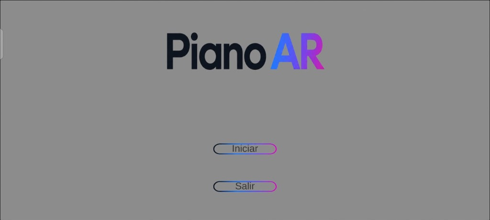
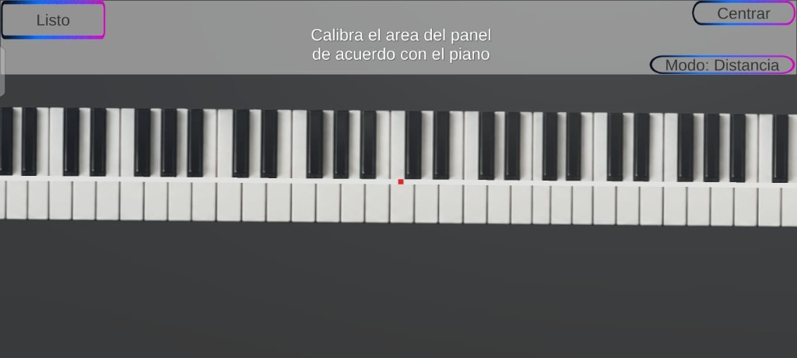
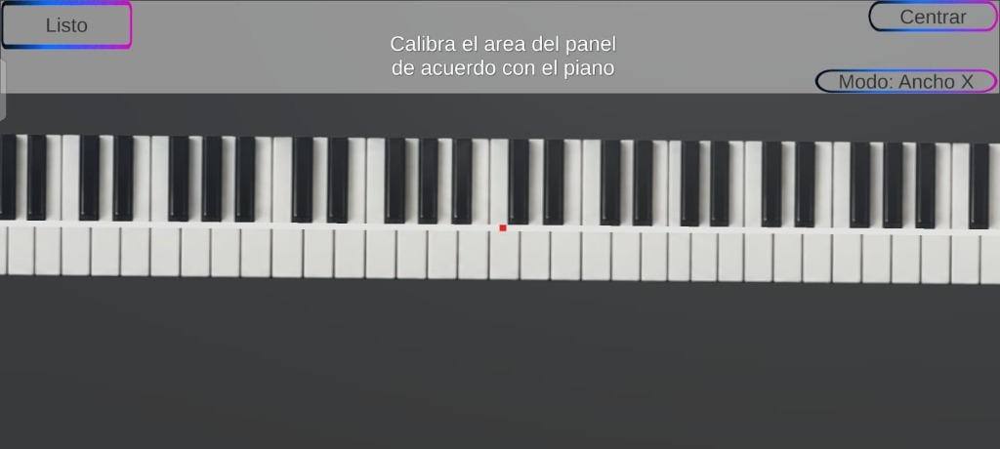
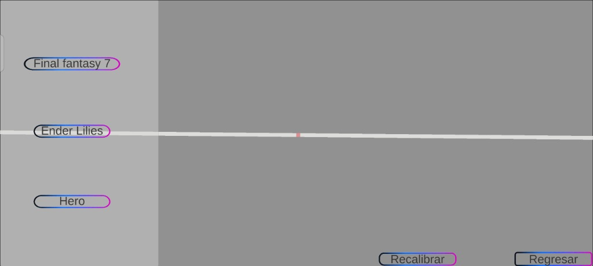
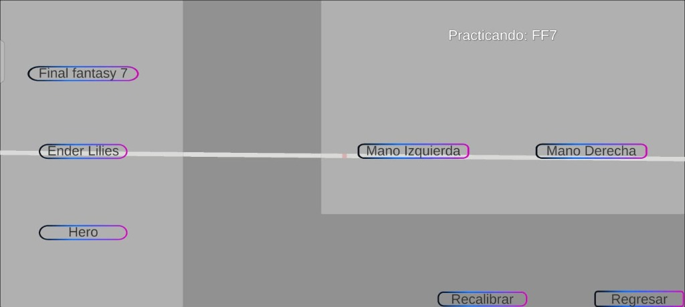
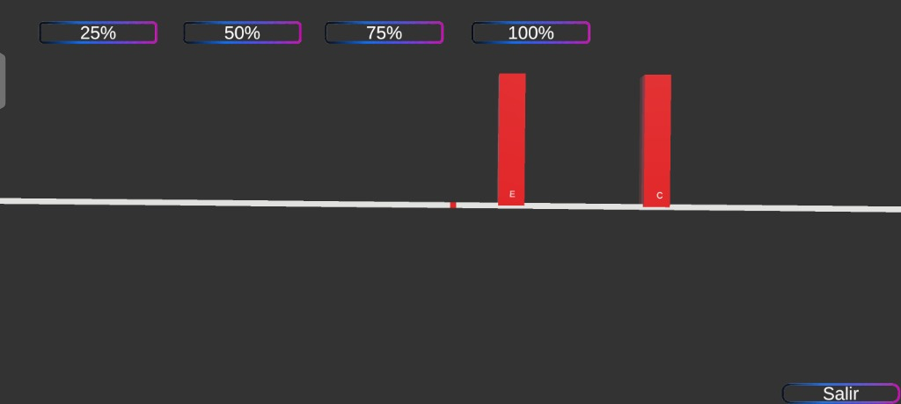

# MANUAL DE USUARIO Y GUÍA RÁPIDA DE PRÁCTICA
**Versión de la Aplicación:** 1.0 (Edición Android AR)  
**Plataforma:** Dispositivos Móviles Android compatibles con ARCore  
**Instrumentos Compatibles:** Pianos acústicos, pianos digitales y teclados electrónicos de tamaño estándar (61, 76 u 88 teclas)

---

## Índice de Contenido
1. Bienvenida a Piano AR
2. Requisitos Previos y Preparación de tu Espacio
3. Paso 1: Menú Principal y Inicio de Sesión
4. Paso 2: Calibración Espacial del Teclado (Alineación AR)
   - 4.1. Uso de la Línea Guía y el Punto Rojo del Do Central (C4)
   - 4.2. Gesto con 1 Dedo: Mover y Acomodar el Panel
   - 4.3. Gesto con 2 Dedos en `Modo: Distancia` (Profundidad e Inclinación)
   - 4.4. Gesto con 2 Dedos en `Modo: Ancho X` (Ajuste del Ancho de Teclas)
5. Paso 3: Catálogo de Canciones y Selección de Mano
6. Paso 4: Pantalla de Práctica en Realidad Aumentada
   - 6.1. Lectura de la Cascada de Notas y Efecto de Consumo
   - 6.2. Control de Velocidad en Tiempo Real (25%, 50%, 75% y 100%)
7. Consejos de Práctica y Solución de Problemas Frecuentes (FAQ)

---

## 1. Bienvenida a Piano AR

**Piano AR** es una aplicación interactiva de aprendizaje musical en **Realidad Aumentada** que transforma tu piano o teclado físico en una estación visual de aprendizaje guiado. A través de la cámara de tu teléfono inteligente, la aplicación proyecta una cascada tridimensional de notas musicales directamente sobre las teclas reales de tu instrumento, permitiéndote aprender canciones paso a paso, practicar cada mano por separado y ajustar la velocidad de la música a tu propio ritmo sin necesidad de saber leer partituras tradicionales desde el primer día.

---

## 2. Requisitos Previos y Preparación de tu Espacio

Antes de iniciar tu sesión de práctica, asegúrate de contar con los siguientes elementos para obtener la mejor experiencia visual y sonora:

| Elemento Requerido | Recomendación de Uso |
| :--- | :--- |
| **Teléfono Android con ARCore** | Utiliza tu dispositivo en orientación **horizontal (paisaje)** y autoriza el permiso de acceso a la cámara cuando la aplicación lo solicite. |
| **Teclado o Piano de Tamaño Estándar** | El instrumento debe estar encendido y con volumen adecuado para que escuches tanto tus notas reales como la pista guía del teléfono. |
| **Soporte o Trípode para Celular** | Coloca tu teléfono en un trípode o soporte estable frente al teclado (o ligeramente por encima a la altura de tu vista), apuntando hacia el centro del piano. |
| **Iluminación Adecuada** | Practica en una habitación bien iluminada, evitando reflejos directos de focos muy intensos sobre las teclas blancas para que la cámara AR mantenga una referencia espacial firme. |

---

## 3. Paso 1: Menú Principal e Inicio de Sesión

Al abrir **Piano AR**, verás la pantalla de bienvenida con el logotipo oficial de la aplicación y dos botones principales con borde degradado en tonos negro, azul eléctrico y magenta:

* **Botón `Iniciar`**: Comienza tu sesión en la aplicación. Si es la primera vez que entras desde que abriste la app, el sistema te llevará automáticamente al **Modo de Calibración** para alinear el piano virtual con tu instrumento físico.
* **Botón `Salir`**: Cierra por completo la aplicación y regresa a la pantalla de inicio de tu dispositivo Android.

---

## 4. Paso 2: Calibración Espacial del Teclado (Alineación AR)

La calibración es el paso más importante para garantizar que cada nota que caiga en la pantalla coincida milimétricamente con la tecla física correcta de tu piano. Al entrar por primera vez, verás el mensaje superior **"Calibra el area del panel de acuerdo con el piano"** junto con una plantilla guía superpuesta a la imagen de tu cámara.

### 4.1. Uso de la Línea Guía y el Punto Rojo del Do Central (C4)
Observa con atención la línea blanca horizontal que aparece en pantalla:
* Justo en el centro de la línea blanca hay un **pequeño cuadro de color rojo**.
* Ese **punto rojo** indica exactamente la posición del **Do Central (C4)** de tu piano. Tu objetivo durante la calibración es hacer que la línea blanca descanse sobre el borde de tus teclas y que el **punto rojo quede justo encima de la tecla Do Central (C4)** de tu teclado físico.

### 4.2. Gesto con 1 Dedo: Mover y Acomodar el Panel
* **Deslizar con 1 dedo**: Toca cualquier parte libre de la pantalla con **un solo dedo** y arrástralo hacia arriba, abajo, izquierda o derecha. La línea guía y el teclado virtual se moverán siguiendo tu dedo para que puedas colocar el **punto rojo** sobre el Do Central de tu piano.

### 4.3. Gesto con 2 Dedos en `Modo: Distancia` (Profundidad e Inclinación)
En la esquina superior derecha encontrarás el botón selector de modo. Por defecto inicia en **`Modo: Distancia`**:

Cuando el botón indica **`Modo: Distancia`**, utilizar **dos dedos al mismo tiempo** sobre la pantalla te permite hacer dos ajustes espaciales:
1. **Pellizcar con 2 dedos (Separar o juntar dedos)**: Acerca o aleja el panel en profundidad hacia el fondo o hacia la cámara.
2. **Girar con 2 dedos (Rotar en pantalla)**: Inclina el ángulo de la línea blanca para que quede completamente paralela y nivelada con la inclinación horizontal de tu teclado físico.

### 4.4. Gesto con 2 Dedos en `Modo: Ancho X` (Ajuste del Ancho de Teclas)
Una vez que la línea blanca ya esté nivelada y a la distancia correcta, toca el botón **`Modo: Distancia`** en la esquina superior derecha para que cambie a **`Modo: Ancho X`**:

Cuando el botón indica **`Modo: Ancho X`**:
* **El giro queda bloqueado automáticamente** para que no desniveles la línea por accidente.
* **Pellizcar con 2 dedos (Separar o juntar dedos)**: Estira o encoge horizontalmente el ancho del teclado virtual hasta que el ancho de las teclas de la guía coincida exactamente con las teclas blancas y negras de tu piano real de extremo a extremo.

### Resumen de Botones de la Pantalla de Calibración
| Botón en Pantalla | Ubicación | Función Principal |
| :--- | :--- | :--- |
| **`Centrar`** | Esquina superior derecha | Si moviste demasiado el panel y lo perdiste de vista, toca **`Centrar`** para traer la línea guía de regreso justo frente a tu cámara (a 40 cm). |
| **`Modo: Distancia` / `Modo: Ancho X`** | Arriba a la derecha (debajo de Centrar) | Alterna la función del gesto de 2 dedos entre **acercar/alejar y rotar** (`Modo: Distancia`) o **ajustar el ancho horizontal de las teclas** (`Modo: Ancho X`). |
| **`Listo`** | Esquina superior izquierda | Guarda y congela la posición del piano en el espacio para que no se mueva mientras tocas, y te lleva al catálogo de canciones. |

---

## 5. Paso 3: Catálogo de Canciones y Selección de Mano

Al presionar **`Listo`** en la pantalla de calibración, accederás al menú de **Selección de Canciones**. Observarás que la línea blanca con el punto rojo del Do Central permanece fija en el fondo sobre tu piano como referencia visual:

### 5.1. Escuchar la Vista Previa de una Canción
En la columna del lado izquierdo encontrarás las pistas disponibles en la biblioteca:
* **`Final fantasy 7`**
* **`Ender Lilies`**
* **`Hero`**

Al tocar cualquiera de estos tres botones:
1. La aplicación reproducirá inmediatamente una **vista previa en audio** de la canción seleccionada para que escuches su melodía y ritmo.
2. En la parte derecha de la pantalla se abrirá automáticamente el panel **"Practicando: [Nombre de la canción]"** con las opciones de mano.

### 5.2. Elegir qué Mano Practicar
Una vez seleccionada tu canción, elige en el panel derecho con qué mano deseas realizar tu lección:
* **Botón `Mano Izquierda`**: Carga la partitura en cascada correspondiente al acompañamiento y acordes bajos de la mano izquierda.
* **Botón `Mano Derecha`**: Carga la partitura en cascada correspondiente a la melodía principal de la mano derecha.

### 5.3. Opciones Adicionales de Navegación
En la esquina inferior derecha dispones de dos botones de apoyo:
* **Botón `Recalibrar`**: Si moviste tu trípode o tu teléfono sin querer, toca este botón para volver a la pantalla de calibración y reajustar la línea guía sobre el piano.
* **Botón `Regresar`**: Vuelve a la portada del Menú Principal.

---

## 6. Paso 4: Pantalla de Práctica en Realidad Aumentada

En cuanto tocas **`Mano Izquierda`** o **`Mano Derecha`**, la aplicación limpia los menús y comienza una **cuenta regresiva de 3 segundos (`3`, `2`, `1`, `¡A TOCAR!`)** en el centro de la pantalla.

* **Anticipación Visual**: Desde el segundo `3`, verás que las primeras barras de notas ya vienen descendiendo suavemente desde la parte superior hacia la línea blanca de tu teclado. Justo cuando aparece el mensaje **`¡A TOCAR!`**, la primera nota toca la línea blanca y arranca la música sincronizada.

### 6.1. Lectura de la Cascada de Notas y Efecto de Consumo
* **Posición y Altura de la Nota**: Cada barra vertical cae exactamente sobre la tecla que debes presionar. El **largo vertical de la barra** indica durante cuánto tiempo debes mantener presionada esa tecla.
* **Nombre de la Nota en Cifrado (`C`, `D`, `E`, `F`, `G`, `A`, `B`)**: En la base inferior de cada barra aparece escrita la letra de la nota en cifrado americano (por ejemplo, **`E`** para *Mi*, **`C`** para *Do*, **`F#`** para *Fa sostenido*), ayudándote a identificar rápidamente cada nota.
* **Efecto Visual de Absorción en la Línea de Golpe**: Cuando la base de una nota toca la línea blanca sobre tu teclado, la barra se detiene en la línea y **se va encogiendo (consumiendo)** mientras suena. Debes mantener presionada la tecla física hasta que la barra termine de consumirse por completo.

### 6.2. Control de Velocidad en Tiempo Real (25%, 50%, 75% y 100%)
En la parte superior de la pantalla de práctica tienes 4 botones para controlar la velocidad de la lección en cualquier momento (incluso durante la cuenta regresiva o a mitad de la canción). Al tocarlos, **tanto la caída de las notas como el audio de la canción cambian de velocidad al mismo tiempo** sin perder la sincronización:

| Botón de Velocidad | Nivel Recomendado | Descripción del Ritmo |
| :--- | :--- | :--- |
| **`25%`** | **Familiarización Inicial** | Cámara ultra lenta (un cuarto de la velocidad original). Ideal para ubicar por primera vez dónde va cada dedo en pasajes rápidos. |
| **`50%`** | **Práctica Básica** | Mitad de velocidad. Excelente para practicar la coordinación y digitación sin presión de tiempo. |
| **`75%`** | **Práctica Intermedia** | Velocidad moderada, perfecta como paso previo antes de tocar la canción a tempo real. |
| **`100%`** | **Tempo Real** | Velocidad original de la pieza musical tal como fue compuesta. |

* **Botón `Salir` (Esquina inferior derecha)**: Detiene de inmediato la música, limpia las notas de la pantalla y te devuelve al Menú Principal para descansar o elegir otra pista.

---

## 7. Consejos de Práctica y Solución de Problemas Frecuentes (FAQ)

| Situación o Pregunta | Causa Probable y Solución Rápida |
| :--- | :--- |
| **Las notas del centro coinciden con mi piano, pero las de los extremos (izquierda o derecha) quedan corridas.** | El ancho horizontal de la cascada es ligeramente más grande o más pequeño que tu teclado. Ve a **`Recalibrar`**, toca el botón de modo para ponerlo en **`Modo: Ancho X`** y usa **2 dedos** para estirar o encoger el ancho hasta que todas las octavas encajen con tus teclas reales. |
| **La línea blanca se ve chueca o inclinada respecto a mi piano.** | Entra a **`Recalibrar`**, asegúrate de que el botón superior derecho diga **`Modo: Distancia`** y gira **2 dedos** sobre la pantalla como si giraras un volante hasta que la línea blanca quede completamente paralela a tus teclas. |
| **Perdí de vista la línea blanca durante la calibración.** | Presiona el botón **`Centrar`** en la esquina superior derecha de la pantalla de calibración; la línea guía reaparecerá inmediatamente justo frente a la cámara de tu teléfono. |
| **¿Cuál es la mejor forma de aprender una canción nueva desde cero?** | 1. Elige **`Mano Derecha`** y baja la velocidad a **`25%`** o **`50%`** hasta memorizar la melodía. 2. Sube gradualmente a **`75%`** y luego a **`100%`**. 3. Repite el proceso con **`Mano Izquierda`** para dominar el acompañamiento. |
