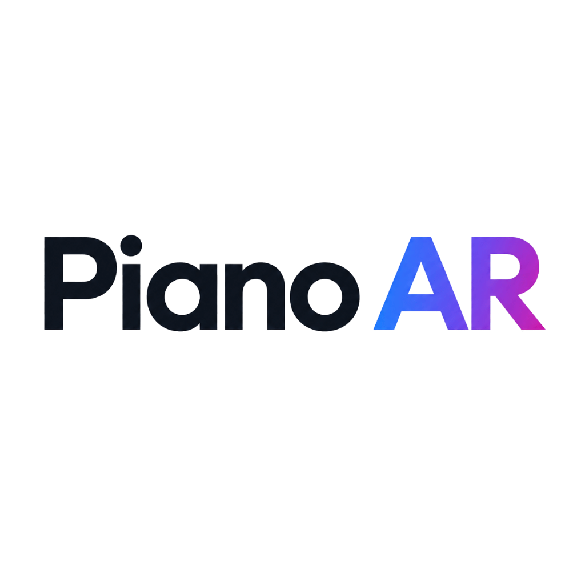
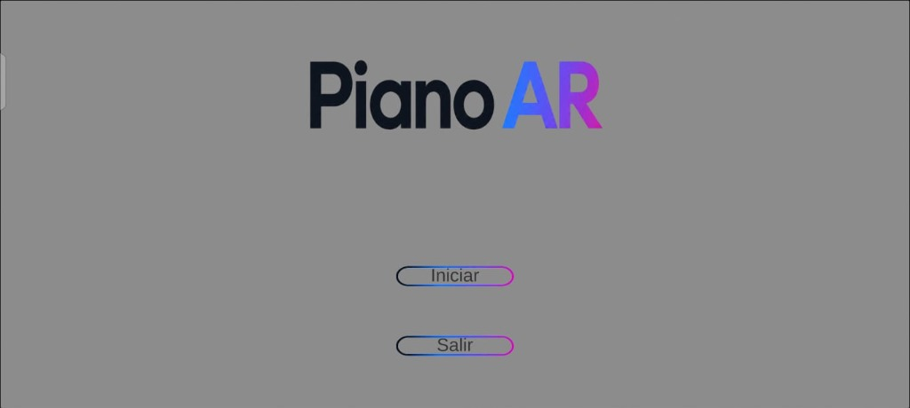
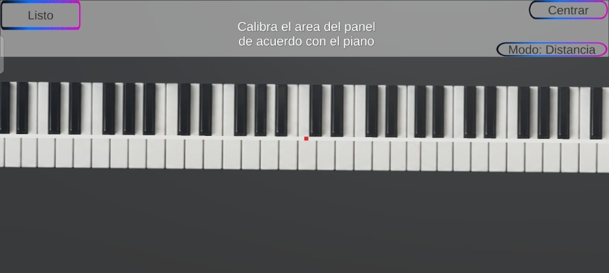
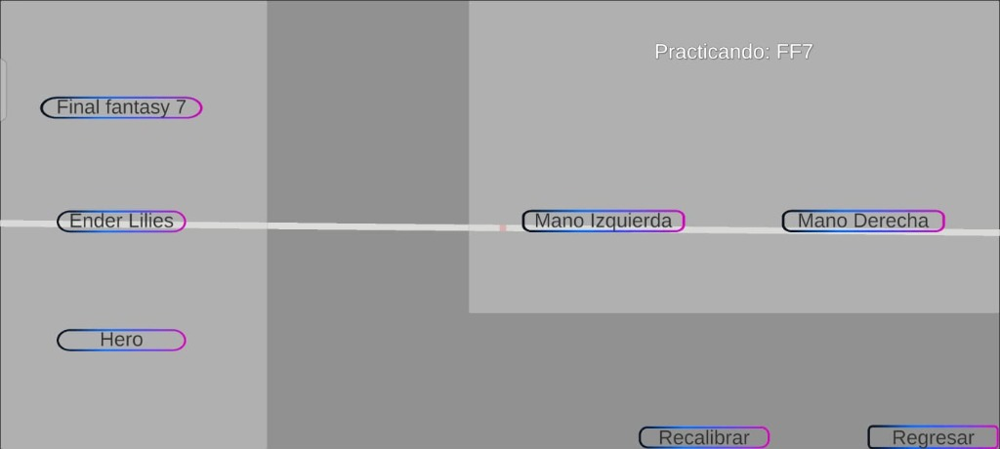
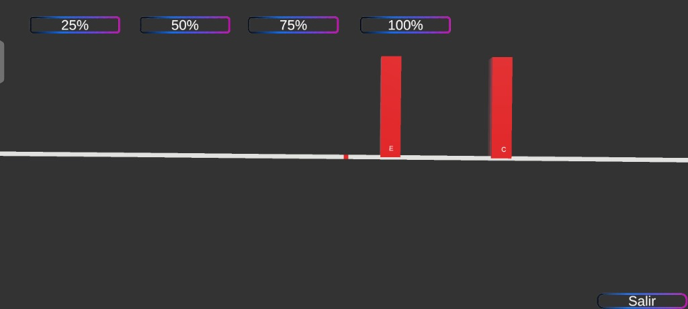
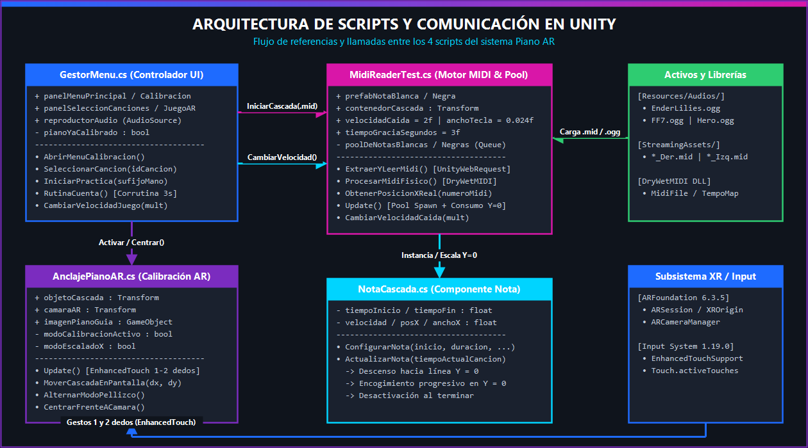

<div align="center">

  

  # 🎹 Piano AR

  **Aplicación móvil de Realidad Aumentada (ARCore) desarrollada en Unity 6 para el aprendizaje guiado de piano mediante cascada tridimensional de notas MIDI sobre teclados físicos reales.**

  [](https://unity.com/)
  [](https://docs.unity3d.com/Packages/com.unity.xr.arfoundation@6.3/manual/index.html)
  [](https://developers.google.com/ar)
  [](https://melanchall.github.io/drywetmidi/)

</div>

---

## 📖 Descripción del Proyecto

**Piano AR** es un proyecto desarrollado dentro de la temática de **Educación e Innovación Tecnológica** para la asignatura de *Temas Selectos de Realidad Virtual y Realidad Aumentada* (Facultad de Ingeniería, UNAM).

A diferencia del aprendizaje tradicional basado únicamente en la lectura de partituras (solfeo), **Piano AR** utiliza el piano o teclado físico del estudiante como referencia espacial y proyecta una interfaz tridimensional en cascada (inspirada en herramientas visuales como *Synthesia* y *PianoVision*) directamente sobre las teclas reales a través de la cámara del dispositivo móvil.

Además, su arquitectura modular está pensada para que **escuelas e instituciones de música con área de producción musical** puedan integrar sus propios archivos `.mid` y pistas de audio `.ogg` producidas internamente en cualquier DAW (como FL Studio, Ableton o Logic), eliminando costos de licenciamiento de terceros.

---

## ✨ Características Principales

* **🎯 Calibración Espacial Multitáctil (`EnhancedTouch`) con Silueta Guía:**
  * **Punto Rojo de Referencia (Do Central / C4):** Línea guía en pantalla para alinear el centro exacto del teclado físico.
  * **Gesto de 1 Dedo:** Arrastre libre de la cascada sobre el plano de la cámara AR.
  * **Gesto de 2 Dedos en `Modo: Distancia`:** Ajuste de profundidad (acercar/alejar) y rotación trigonométrica para nivelar la inclinación del teclado.
  * **Gesto de 2 Dedos en `Modo: Ancho X`:** Escalado horizontal de precisión con bloqueo automático de rotación para adaptar el ancho de las octavas a cualquier teclado estándar.
* **🎼 Decodificación MIDI a Escala Física Real:**
  * Lectura nativa de archivos binarios `.mid` mediante **Melanchall DryWetMIDI**, respetando el `TempoMap` y traduciendo cada nota (0–127) a coordenadas métricas reales ($2.4\text{ cm}$ por tecla blanca) con distinción entre notas naturales y sostenidos (`#`).
* **🔥 Efecto Visual de Consumo en Línea de Golpe ($Y = 0$) y Object Pooling:**
  * Al tocar el borde de las teclas físicas ($Y = 0$), la base de la nota se detiene y la barra se encoge progresivamente mientras suena, manteniendo visible su etiqueta en cifrado americano (`C`, `C#`, `D`, `E`, etc.) sin deformar el texto `TextMeshPro`.
  * Sistema de reciclaje con colas (`Queue<GameObject>`) para notas blancas y negras que evita tirones por *Garbage Collection* y mantiene una tasa estable de cuadros por segundo.
* **⏱️ Modulador de Tempo Sincronizado (25%, 50%, 75% y 100%):**
  * Control en tiempo real que ajusta simultáneamente la velocidad de caída geométrica de las notas y el `pitch` del `AudioSource`, incluyendo una cuenta regresiva inteligente de 3 segundos con colchón espacial de anticipación.
* **👐 Práctica Independiente por Mano:**
  * Catálogo precargado (*Final Fantasy VII*, *Ender Lilies*, *Hero*) con pistas separadas para **Mano Izquierda** (`_Izq.mid`) y **Mano Derecha** (`_Der.mid`).

---

## 📸 Capturas de Pantalla del Flujo de la Aplicación

| 1. Menú Principal | 2. Calibración (`Modo: Distancia` y `Modo: Ancho X`) |
| :---: | :---: |
|  |  |

| 3. Selección de Canción y Mano | 4. Práctica en Realidad Aumentada (Cascada + Tempo) |
| :---: | :---: |
|  |  |

---

## 🏗️ Arquitectura de Scripts y Diagramas Técnicos

El núcleo lógico del proyecto se encuentra en `PianoAR/Assets/Scripts/` y se divide en 4 clases principales:

1. **`AnclajePianoAR.cs`:** Controlador de calibración espacial táctil con `UnityEngine.InputSystem.EnhancedTouch`, rotación angular (`Mathf.Atan2`) y escalado horizontal restringido (`Mathf.Clamp`).
2. **`GestorMenu.cs`:** Máquina de estados de la interfaz de usuario (UI), validación obligatoria de calibración inicial (`pianoYaCalibrado`), reproducción de vistas previas y corrutina de cuenta regresiva sincronizada (`RutinaCuenta()`).
3. **`MidiReaderTest.cs`:** Motor de extracción de `StreamingAssets` en Android (`UnityWebRequest`), lectura de archivos `.mid` con DryWetMIDI, cálculo geométrico de octavas, *Object Pool* y algoritmo de consumo en $Y = 0$.
4. **`NotaCascada.cs`:** Componente modular de ciclo de vida individual de nota en cascada (`ConfigurarNota` y `ActualizarNota`).

<div align="center">
  
</div>

---

## 📂 Estructura del Repositorio

```text
PianoAR/
├── Assets/
│   ├── Marcadores/           # Imágenes de referencia y XRReferenceImageLibrary
│   ├── Materiales/           # Materiales para notas blancas, sostenidos y paneles UI
│   ├── Melanchall/           # Librería DryWetMIDI (.dll) para lectura de archivos .mid
│   ├── Prefabs/              # Prefabs NotaBlancaBase 1 y NotaNegraBase 1 (pivote en base)
│   ├── Resources/Audios/     # Pistas de audio (.ogg): EnderLilies, FF7 y Hero
│   ├── Scenes/               # Escena principal de producción: Piano.unity
│   ├── Scripts/              # Scripts en C#: AnclajePianoAR, GestorMenu, MidiReaderTest, NotaCascada
│   ├── StreamingAssets/      # Archivos MIDI separados por mano (*_Der.mid y *_Izq.mid)
│   ├── UI/                   # Recursos gráficos de interfaz y plantilla guía del piano
│   └── XR/                   # Configuraciones de ARCore Loader y XR Simulation
├── Packages/                 # Manifiesto de paquetes (ARFoundation 6.3.5, ARCore 6.3.5, InputSystem 1.19.0)
├── ProjectSettings/          # Configuración del proyecto en Unity 6 (6000.3.11f1)
└── documentacion/            # Manual Técnico y Manual de Usuario (.docx y .md) + Diagramas
    ├── Manual_Tecnico_PianoAR.docx
    ├── Manual_Tecnico_PianoAR.md
    ├── Manual_de_Usuario_PianoAR.docx
    ├── Manual_de_Usuario_PianoAR.md
    └── img/
```

---

## 📑 Documentación Completa (Manuales de Entrega Final)

Dentro de la carpeta [`PianoAR/documentacion/`](PianoAR/documentacion/) se encuentran disponibles los manuales oficiales del proyecto tanto en formato **Microsoft Word (`.docx`)** como en **Markdown (`.md`)**:

* 📘 **[Manual Técnico (`Manual_Tecnico_PianoAR.docx`)](PianoAR/documentacion/Manual_Tecnico_PianoAR.docx)** | **[Versión Markdown](PianoAR/documentacion/Manual_Tecnico_PianoAR.md)**
  * Incluye comparativa del cronograma propuesto vs. real, tecnologías utilizadas, estructura del proyecto, explicación matemática de procedimientos, documentación exhaustiva línea por línea de los scripts, diagramas de flujo, análisis de costos reales, viabilidad B2B para escuelas de música y determinación del precio.
* 📗 **[Manual de Usuario (`Manual_de_Usuario_PianoAR.docx`)](PianoAR/documentacion/Manual_de_Usuario_PianoAR.docx)** | **[Versión Markdown](PianoAR/documentacion/Manual_de_Usuario_PianoAR.md)**
  * Guía visual paso a paso sobre la preparación del espacio, uso de los gestos de 1 y 2 dedos para calibrar el piano, selección de canciones y manos, uso del modulador de velocidad (`25%` a `100%`) y solución de preguntas frecuentes (FAQ).

---

## 🚀 Requisitos e Instalación para Desarrollo o Compilación

1. **Clonar el repositorio:**
   ```bash
   git clone https://github.com/Fernando-David/PianoAR.git
   ```
2. **Abrir en Unity Hub:**
   * Agregar la carpeta `PianoAR` desde Unity Hub utilizando **Unity 6 (versión `6000.3.11f1` o compatible)** con el módulo **Android Build Support (SDK / NDK / OpenJDK)** instalado.
3. **Abrir la escena principal:**
   * Navegar a `Assets/Scenes/Piano.unity`.
4. **Compilar para Android (APK):**
   * Ir a `File -> Build Profiles -> Android`, asegurarse de tener un dispositivo Android compatible con **Google Play Services for AR (ARCore)** y presionar **Build** o **Build and Run**.

---

## 👨‍💻 Autor y Datos Académicos

* **Desarrollador:** Fernando David Martínez Navarro
* **Institución:** Universidad Nacional Autónoma de México (UNAM) — Facultad de Ingeniería
* **Carrera:** Ingeniería en Computación (División de Ingeniería Eléctrica)
* **Asignatura:** Temas Selectos 3: de Realidad Virtual y Realidad Aumentada
* **Repositorio:** [https://github.com/Fernando-David/PianoAR](https://github.com/Fernando-David/PianoAR)
